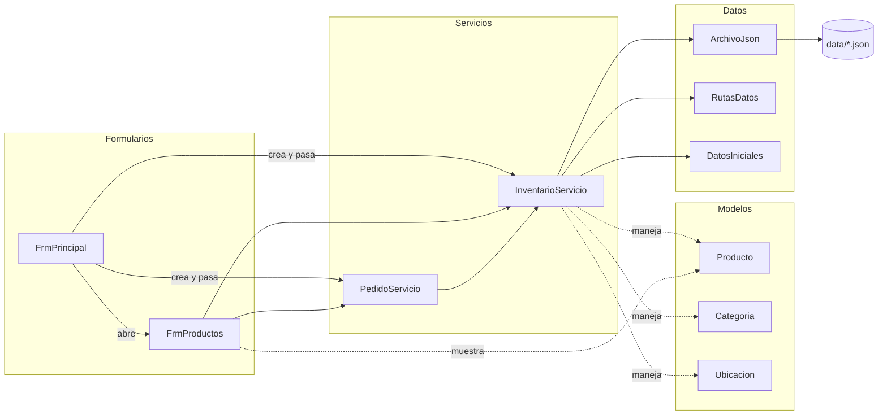
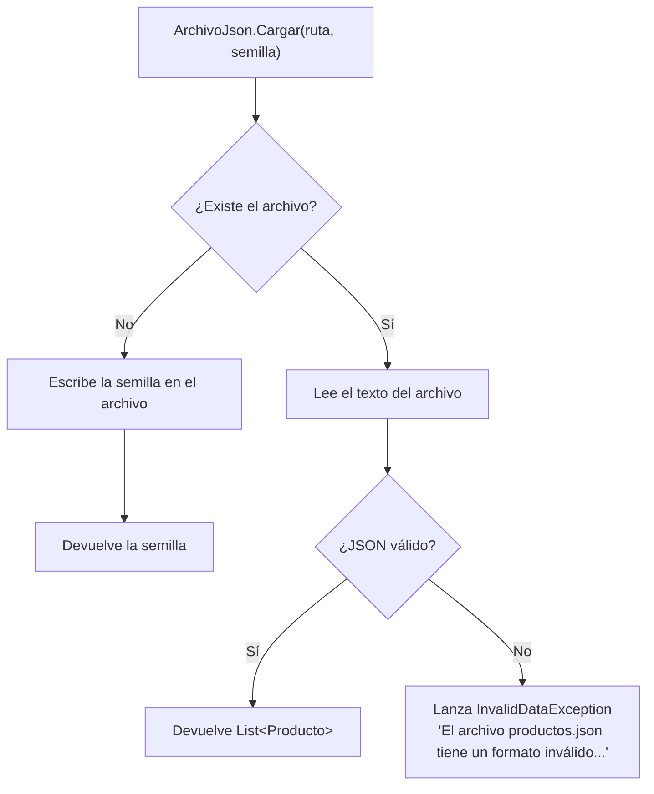
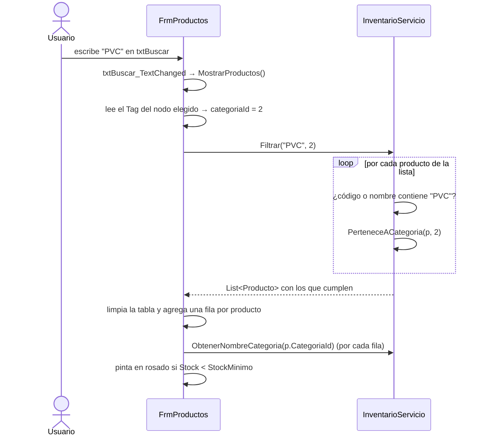
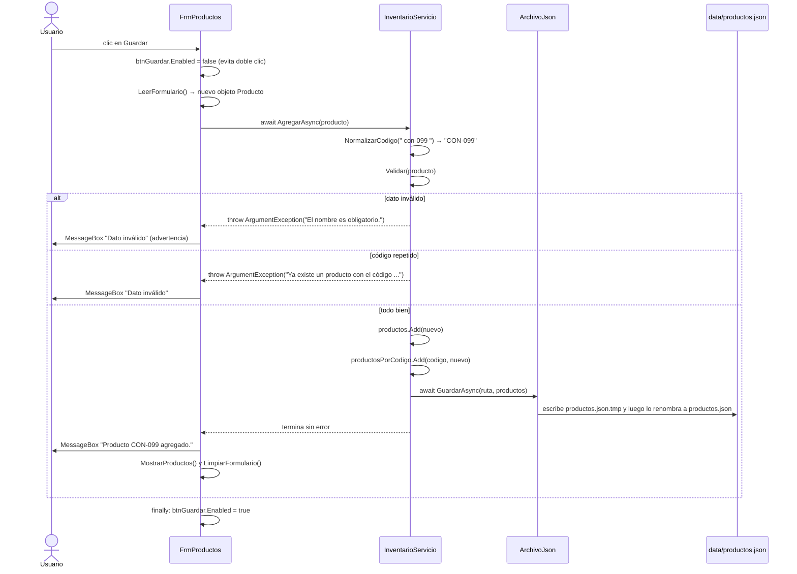
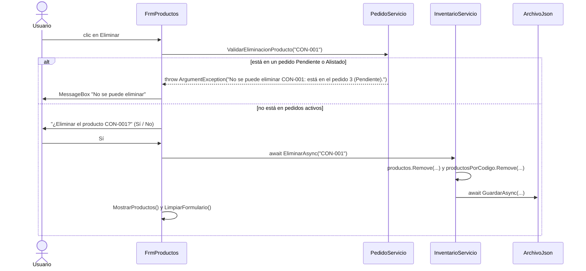

# Guía de estudio 1 — Formulario de Productos (`FrmProductos`)

> **Objetivo de esta guía:** que usted pueda explicar, en la sustentación, qué clases participan
> cuando el usuario crea, busca, edita o elimina un producto, y **por qué** cada clase hace lo que hace.

---

## 1. ¿Qué hace esta pantalla?

Es el **CRUD de productos** (Crear, Leer, Actualizar —*Update*—, Eliminar —*Delete*—). Tiene tres zonas:

```
┌───────────────────┬──────────────────────────────────┬──────────────────────────┐
│ ÁRBOL DE          │ Buscar: [ código o nombre ] [Ver todos]   40 productos       │
│ CATEGORÍAS        ├──────────────────────────────────┤ DATOS DEL PRODUCTO       │
│                   │ Código │ Nombre │ Categoría │... │  Código   [        ]     │
│ Todas             │ CON-001│ Cemento│ Cementos  │    │  Nombre   [        ]     │
│ ├ Construcción    │ CON-002│ ...    │           │    │  Categoría[ ▼ ]          │
│ │ ├ Cementos      │ (en rosado los que están bajo    │  ...                     │
│ │ └ Agregados     │  el stock mínimo)                │ [Nuevo][Guardar][Eliminar]│
│ └ Plomería ...    │                                  │                          │
│  tvCategorias     │  dgvProductos                    │  grpDatos                │
└───────────────────┴──────────────────────────────────┴──────────────────────────┘
```

| Zona | Control | Para qué sirve |
|---|---|---|
| Izquierda | `tvCategorias` (TreeView) | Filtrar la tabla por categoría (árbol de 2 niveles). |
| Centro arriba | `txtBuscar`, `btnLimpiarBusqueda` | Buscar por código o nombre. |
| Centro | `dgvProductos` (DataGridView) | Ver la lista de productos. |
| Derecha | `txtCodigo`, `txtNombre`, `cmbCategoria`, `cmbUnidad`, `nud...`, `cmbUbicacion` | Escribir los datos de un producto. |
| Derecha abajo | `btnNuevo`, `btnGuardar`, `btnEliminar` | Acciones. |

Los controles se crean en `FrmProductos.Designer.cs` (lo genera el diseñador de Visual Studio).
El código que **nosotros** escribimos está en `FrmProductos.cs`.

---

## 2. Archivos que participan (la "trazabilidad")

| Carpeta | Archivo | Papel en esta pantalla |
|---|---|---|
| `Formularios/` | `FrmPrincipal.cs` | **Crea** los servicios y **abre** `FrmProductos`. |
| `Formularios/` | `FrmProductos.cs` | Muestra datos y captura lo que escribe el usuario. |
| `Formularios/` | `FrmProductos.Designer.cs` | Crea los controles y conecta cada evento con su método. |
| `Servicios/` | `InventarioServicio.cs` | **Toda la lógica**: buscar, filtrar, validar, agregar, editar, eliminar. |
| `Servicios/` | `PedidoServicio.cs` | Solo un método: revisa que el producto no esté en un pedido activo antes de eliminarlo. |
| `Modelos/` | `Producto.cs` | La "ficha" de un producto (código, nombre, precios, stock...). |
| `Modelos/` | `Categoria.cs` | Una categoría; `PadreId` arma el árbol de dos niveles. |
| `Modelos/` | `Ubicacion.cs` | Un espacio de estante (ej. `A-01-2`). |
| `Datos/` | `ArchivoJson.cs` | Lee y guarda las listas en archivos JSON. |
| `Datos/` | `RutasDatos.cs` | Dice **dónde** están los archivos (`data/productos.json`, ...). |
| `Datos/` | `DatosIniciales.cs` | Datos de ejemplo que se usan si el archivo no existe. |
| `data/` | `productos.json`, `categorias.json`, `ubicaciones.json` | Los datos guardados en disco. |
| `FerreStock.Pruebas/` | `InventarioServicioPruebas.cs` | Pruebas automáticas del servicio. |

### Diagrama de dependencias

Una flecha `A --> B` significa "A **usa** a B" (A tiene una variable de tipo B o llama a sus métodos).



**Fíjese:** `FrmProductos` **no** tiene ninguna flecha hacia `Datos/` ni hacia los archivos JSON.
Eso es a propósito: el formulario solo habla con los servicios.

---

## 3. ¿Cómo llega el programa hasta esta pantalla?

```
Program.Main()                                   (Program.cs)
   └─ abre FrmLogin  → el usuario entra
        └─ abre FrmPrincipal(usuario)
              └─ FrmPrincipal_Load(...)          (FrmPrincipal.cs:55)
                    inventario = new InventarioServicio();      ← lee los JSON UNA sola vez
                    movimientos = new MovimientoServicio(inventario);
                    pedidos    = new PedidoServicio(inventario, movimientos);
                    ...
              └─ clic en "Productos" → AbrirProductos()        (FrmPrincipal.cs:102)
                    new FrmProductos(inventario, pedidos).ShowDialog();
```

### Idea clave: los servicios se crean **una sola vez** y se **comparten**

`FrmPrincipal` crea un único `InventarioServicio` y se lo **pasa** (por el constructor) a cada
formulario que lo necesite: Productos, Movimientos, Pedidos, Calculadora...

```csharp
// FrmProductos.cs:20
public FrmProductos(InventarioServicio inventario, PedidoServicio pedidos)
{
    InitializeComponent();
    this.inventario = inventario;   // se guarda para usarlo en los demás métodos
    this.pedidos = pedidos;
}
```

**¿Por qué así y no `new InventarioServicio()` dentro de `FrmProductos`?**
Porque si cada formulario creara el suyo, cada uno tendría **su propia copia** de la lista de
productos. Si en Movimientos se registra una entrada de 10 cementos, Productos no se enteraría.
Al compartir **el mismo objeto**, todas las pantallas ven los mismos datos en memoria.

> Analogía: es como si toda la ferretería trabajara sobre **un mismo cuaderno de inventario**,
> en vez de que cada empleado tenga su propia fotocopia.

`ShowDialog()` abre la ventana y **espera** a que se cierre. Cuando se cierra, `FrmPrincipal`
llama `ActualizarBarraEstado()` para refrescar el conteo de productos de la barra inferior.

---

## 4. ¿Qué pasa cuando se crea `InventarioServicio`? (carga de datos)

```csharp
// InventarioServicio.cs:29
public InventarioServicio()
{
    categorias  = ArchivoJson.Cargar(RutasDatos.Categorias,  DatosIniciales.CrearCategorias());
    ubicaciones = ArchivoJson.Cargar(RutasDatos.Ubicaciones, DatosIniciales.CrearUbicaciones());
    productos   = ArchivoJson.Cargar(RutasDatos.Productos,   DatosIniciales.CrearProductos());
    // ... luego llena el diccionario productosPorCodigo
}
```

Paso a paso para la línea de productos:

1. `RutasDatos.Productos` devuelve la ruta completa, por ejemplo
   `C:\...\bin\Debug\net8.0-windows\data\productos.json`.
2. `DatosIniciales.CrearProductos()` arma una lista con unos 40 productos de ejemplo (la "semilla").
3. `ArchivoJson.Cargar(...)`:
   - Si el archivo **no existe** → lo crea con la semilla y devuelve la semilla.
   - Si **existe** → lo lee y lo convierte (deserializa) en una `List<Producto>`.
   - Si el archivo está **mal escrito** → lanza `InvalidDataException` con un mensaje claro.



4. Con la lista cargada, se llena un **diccionario** `productosPorCodigo`. Si hay un código repetido
   en el JSON (alguien lo editó a mano), se lanza un error en vez de seguir con datos dañados.

### ¿Por qué hay una lista **y** un diccionario con los mismos productos?

| Estructura | Sirve para | Costo de buscar por código |
|---|---|---|
| `List<Producto> productos` | Mantener el **orden** (mostrar en la tabla y guardar en el JSON). | O(n): hay que recorrerla. |
| `Dictionary<string, Producto> productosPorCodigo` | Encontrar un producto **por su código** al instante. | O(1) en promedio. |

Las dos guardan **los mismos objetos** (no copias). Por eso, cada vez que se agrega o elimina
un producto, el servicio lo hace **en las dos** para que sigan sincronizadas
(ver `AgregarAsync` y `EliminarAsync`).

---

## 5. Los eventos: qué método se ejecuta con cada acción

En `FrmProductos.Designer.cs` cada evento se conecta con un método con `+=`:

```csharp
btnGuardar.Click += btnGuardar_Click;   // "cuando hagan clic en Guardar, ejecute btnGuardar_Click"
```

| Acción del usuario | Evento | Método del formulario | Método(s) del servicio que llama |
|---|---|---|---|
| Se abre la ventana | `Load` | `FrmProductos_Load` | `ObtenerCategoriasPrincipales`, `ObtenerSubcategorias`, `ObtenerTodasLasSubcategorias`, `ObtenerUbicaciones`, `Filtrar` |
| Elige una categoría en el árbol | `tvCategorias.AfterSelect` | `tvCategorias_AfterSelect` → `MostrarProductos` | `Filtrar`, `ObtenerNombreCategoria` |
| Escribe en "Buscar" | `txtBuscar.TextChanged` | `txtBuscar_TextChanged` → `MostrarProductos` | `Filtrar` |
| Clic en "Ver todos" | `btnLimpiarBusqueda.Click` | `btnLimpiarBusqueda_Click` | (vuelve a la raíz del árbol → se dispara `AfterSelect`) |
| Clic en una fila de la tabla | `dgvProductos.CellClick` | `dgvProductos_CellClick` → `CargarEnFormulario` | `BuscarPorCodigo` |
| Clic en "Nuevo" | `btnNuevo.Click` | `btnNuevo_Click` → `LimpiarFormulario` | ninguno |
| Clic en "Guardar" | `btnGuardar.Click` | `btnGuardar_Click` → `LeerFormulario` | `AgregarAsync` **o** `EditarAsync` |
| Clic en "Eliminar" | `btnEliminar.Click` | `btnEliminar_Click` | `PedidoServicio.ValidarEliminacionProducto`, luego `EliminarAsync` |

### Los métodos "ayudantes" del formulario

| Método | Qué hace | Dirección del dato |
|---|---|---|
| `CargarArbolCategorias()` | Arma el árbol con las categorías y guarda el `Id` en el `Tag` de cada nodo. | Servicio → pantalla |
| `CargarListasDesplegables()` | Llena los combos de categoría, unidad y ubicación. | Servicio → pantalla |
| `MostrarProductos()` | Pide al servicio la lista filtrada y llena la tabla. | Servicio → pantalla |
| `CargarEnFormulario(p)` | Copia un `Producto` a los controles de la derecha. | Objeto → pantalla |
| `LeerFormulario()` | Crea un `Producto` nuevo con lo que el usuario escribió. | Pantalla → objeto |
| `LimpiarFormulario()` | Deja los campos vacíos, en modo "nuevo". | — |
| `PonerValor(control, valor)` | Evita error si el valor está fuera del rango del `NumericUpDown`. | — |

> Note la simetría: `CargarEnFormulario` va del **objeto a la pantalla** y `LeerFormulario` va de la
> **pantalla al objeto**. Son el "puente" entre lo que ve el usuario y los modelos.

---

## 6. Recorridos completos (trazas) paso a paso

### 6.1 Abrir la pantalla

```
FrmProductos_Load
 ├─ CargarArbolCategorias()
 │    ├─ inventario.ObtenerCategoriasPrincipales()     → [Construcción, Plomería, ...]
 │    └─ por cada una: inventario.ObtenerSubcategorias(id) → [Cementos, Agregados, ...]
 ├─ CargarListasDesplegables()
 │    ├─ inventario.ObtenerTodasLasSubcategorias()     → combo Categoría
 │    ├─ InventarioServicio.Unidades                   → combo Unidad
 │    └─ inventario.ObtenerUbicaciones()               → combo Ubicación
 ├─ LimpiarFormulario()                                → modo "Nuevo producto"
 └─ MostrarProductos()                                 → llena la tabla
```

**Dato curioso para la sustentación:** el árbol se arma con el modelo `Categoria` y su propiedad
`PadreId`. Si `PadreId == null` es una categoría principal; si tiene un número, es hija de esa
categoría. Es un **árbol de dos niveles** representado con una sola lista.

```
Categoria { Id = 1,  Nombre = "Construcción",        PadreId = null }  ← principal
Categoria { Id = 11, Nombre = "Cementos y pegantes", PadreId = 1    }  ← hija de Construcción
Categoria { Id = 12, Nombre = "Agregados",           PadreId = 1    }  ← hija de Construcción
```

### 6.2 Buscar y filtrar

El usuario escribe "PVC" y tiene seleccionada "Plomería" en el árbol.



`Filtrar` (`InventarioServicio.cs:161`) es una **búsqueda lineal**: recorre todos los productos
con un `foreach` y se queda con los que cumplen **dos** condiciones:

1. **Texto:** el código o el nombre contiene lo buscado (sin importar mayúsculas).
2. **Categoría:** `PerteneceACategoria` devuelve `true` si el producto está en esa subcategoría
   **o** si su subcategoría es hija de la categoría elegida. Así, al elegir "Construcción"
   aparecen los cementos, los agregados y el hierro.

Si el nodo elegido es la raíz ("Todas las categorías"), su `Tag` es `null`, entonces
`categoriaId` queda en `null` y no se filtra por categoría.

### 6.3 Seleccionar un producto de la tabla (para editarlo)

```
dgvProductos_CellClick(e)
 ├─ si e.RowIndex < 0 → fue clic en el encabezado → no hace nada
 ├─ codigo = valor de la columna "Código" de esa fila
 ├─ producto = inventario.BuscarPorCodigo(codigo)      ← usa el DICCIONARIO, O(1)
 └─ CargarEnFormulario(producto)
       ├─ copia cada propiedad a su control
       ├─ esNuevo = false                               ← ahora estamos EDITANDO
       ├─ txtCodigo.ReadOnly = true                     ← el código no se puede cambiar
       └─ nudStock.Enabled = false                      ← el stock tampoco (ver abajo)
```

**¿Por qué no se puede cambiar el stock aquí?**
Porque el stock solo debe cambiar con un **movimiento** (entrada, salida o ajuste) en la pantalla
de Movimientos. Así cada cambio queda registrado en el historial y se puede **deshacer** con la pila.
Si se pudiera editar el stock libremente aquí, el inventario dejaría de cuadrar con el historial
— que es justamente uno de los problemas que el proyecto quiere resolver.

### 6.4 Guardar un producto **nuevo**

Este es el recorrido más importante: pasa por **todas las capas**.



Puntos para explicar en la sustentación:

- **`esNuevo`** es una variable `bool` del formulario que decide si se llama `AgregarAsync`
  (crear) o `EditarAsync` (modificar). `LimpiarFormulario` la pone en `true`; `CargarEnFormulario` en `false`.
- **`LeerFormulario` no valida.** Solo copia los datos. Quien valida es el servicio (`Validar`).
  Así la regla está en **un solo lugar** y se puede probar con xUnit sin abrir ventanas.
- **Normalizar el código:** `" con-001 "` y `"CON-001"` se consideran el mismo código
  (se quitan espacios y se pasa a mayúsculas). Así no se cuelan códigos "casi repetidos".
- **`async` / `await`:** guardar en disco puede tardar. Con `await` la ventana **no se congela**
  mientras se escribe el archivo. El método del botón es `async void` porque Windows Forms
  no sabe esperar un `Task`; es la única excepción permitida.
- **`try / catch / finally`:**
  - `catch (ArgumentException)` → error de validación, el mensaje ya viene escrito para el usuario.
  - `catch (Exception)` → cualquier otro problema (por ejemplo, el archivo está bloqueado).
  - `finally` → **siempre** se vuelve a activar el botón, haya error o no.

### 6.5 Guardar **cambios** de un producto existente

Igual que el anterior, pero llama `EditarAsync` (`InventarioServicio.cs:252`):

1. Busca el producto **existente** por código. Si no está → error.
2. Copia el stock actual al objeto de cambios (`cambios.Stock = existente.Stock`) para que
   **no se pueda cambiar el stock** desde aquí.
3. **Valida antes de copiar.** Si se copiara primero y luego fallara la validación, el producto
   quedaría "a medio cambiar" en memoria.
4. Copia propiedad por propiedad del objeto `cambios` al objeto `existente`.
5. Guarda el archivo.

> ¿Por qué se modifica `existente` y no se reemplaza en la lista? Porque la lista y el diccionario
> apuntan **al mismo objeto**. Al cambiar sus propiedades, ambos ven el cambio automáticamente.

### 6.6 Eliminar un producto

Aquí participan **dos servicios**:



**¿Por qué se pregunta a `PedidoServicio`?** Porque `InventarioServicio` no conoce los pedidos.
Si se borrara un producto que está en un pedido sin despachar, al despachar ese pedido el
programa no encontraría el producto. `PedidoServicio.ValidarEliminacionProducto`
(`PedidoServicio.cs:236`) recorre los pedidos que **no** están despachados y, si encuentra el
código en algún ítem, lanza el error.

Por eso `FrmProductos` recibe **dos** servicios en su constructor.

---

## 7. Validaciones (todas en `InventarioServicio.Validar`)

| Regla | Mensaje que ve el usuario | ¿Por qué existe? |
|---|---|---|
| Código vacío | "El código es obligatorio." | El código es la llave del producto. |
| Código repetido (al crear) | "Ya existe un producto con el código ..." | Dos productos con el mismo código romperían el diccionario. |
| Nombre vacío | "El nombre es obligatorio." | |
| Unidad vacía | "La unidad es obligatoria." | |
| Categoría principal o inexistente | "Debe elegir una subcategoría válida." | Los productos solo van en el 2.º nivel del árbol. |
| Precios negativos | "Los precios no pueden ser negativos." | |
| Stock, stock mínimo, ventas o peso negativos | "... no puede(n) ser negativo(s)." | |
| Volumen ≤ 0 | "El volumen unitario debe ser mayor que cero." | Se usa para calcular la ocupación de la bodega. |
| Ubicación que no existe | "La ubicación X no existe en la bodega." | Puede quedar vacía, pero si se escribe debe existir. |

**¿Cómo llega el mensaje del servicio a la pantalla?**

```
InventarioServicio.Validar      throw new ArgumentException("El nombre es obligatorio.");
        │   (el error "sube" por AgregarAsync)
        ▼
FrmProductos.btnGuardar_Click   catch (ArgumentException ex)
                                    MessageBox.Show(ex.Message, "Dato inválido", ...);
```

El servicio **no** usa `MessageBox` (no sabe que existe una ventana). Solo lanza el error con un
texto claro. El formulario lo atrapa y lo muestra. Así el servicio también se puede usar en las
pruebas automáticas.

---

## 8. Guardado seguro en JSON (`ArchivoJson.GuardarAsync`)

```
1. Convierte la lista a texto JSON          (JsonSerializer.Serialize)
2. Escribe ese texto en productos.json.tmp  (File.WriteAllTextAsync)
3. Reemplaza productos.json por el .tmp     (File.Move(..., true))
```

**¿Por qué no se escribe directo en `productos.json`?** Si se va la luz a mitad de la escritura,
el archivo quedaría cortado y el programa no podría volver a abrirlo. Escribiendo primero en un
temporal, el archivo original siempre tiene **los datos viejos completos o los nuevos completos**.

Ejemplo de cómo queda un producto en `data/productos.json`:

```json
{
  "Codigo": "CON-001",
  "Nombre": "Cemento gris 50 kg",
  "CategoriaId": 11,
  "Unidad": "bulto",
  "PrecioCompra": 28000,
  "PrecioVenta": 33500,
  "Stock": 80,
  "StockMinimo": 30,
  "PesoKg": 50,
  "VolumenUnitarioM3": 0.036,
  "UbicacionId": "D-01-1",
  "VentasMes": 120
}
```

Cada propiedad de la clase `Producto` se vuelve una clave del JSON. La propiedad `Descripcion`
**no** aparece porque tiene `[JsonIgnore]`: se calcula con `Codigo + " - " + Nombre`, no hace
falta guardarla.

---

## 9. ¿Quién más usa los productos? (conexión con otras pantallas)

El mismo `InventarioServicio` que usa esta pantalla lo usan los demás servicios:

| Servicio | Qué le pide a `InventarioServicio` | Para qué |
|---|---|---|
| `MovimientoServicio` | `BuscarPorCodigo`, `GuardarAsync` | Sumar/restar stock en entradas y salidas. |
| `PedidoServicio` | `BuscarPorCodigo` | Verificar que el producto exista y tenga stock. |
| `BodegaServicio` | `ObtenerProductos`, `ObtenerUbicaciones` | Dibujar el mapa, ruta de alistamiento, sugerir ubicaciones. |
| `IndicadorServicio` | `ObtenerProductos`, `ObtenerBajoStockMinimo`, `ObtenerUbicaciones` | Rotación, ABC, ocupación. |

Por eso los datos que se crean en Productos (peso, volumen, ubicación, ventas del mes) son tan
importantes: alimentan el **mapa**, el **costo de ubicación**, la **clasificación ABC** y la
**ocupación** de la bodega.

---

## 10. Pruebas automáticas relacionadas

Archivo: `FerreStock.Pruebas/InventarioServicioPruebas.cs`.

Las pruebas usan `CarpetaDatosTemporal`, que cambia `RutasDatos.Carpeta` a una carpeta temporal.
Así cada prueba empieza con los datos de `DatosIniciales` y **no daña** los datos reales.
(Por eso `RutasDatos.Carpeta` tiene `set`.)

Ejemplo:

```csharp
[Fact]
public async Task Agregar_GuardaElProductoEnElArchivo()
{
    InventarioServicio servicio = new InventarioServicio();
    await servicio.AgregarAsync(CrearProductoValido(" nue-001 "));

    // Un servicio nuevo vuelve a leer el archivo: el producto debe seguir ahí.
    InventarioServicio otro = new InventarioServicio();
    Producto? encontrado = otro.BuscarPorCodigo("NUE-001");
    Assert.NotNull(encontrado);
    Assert.Equal("NUE-001", encontrado!.Codigo);
}
```

Esta prueba demuestra tres cosas a la vez: que se agrega, que se **normaliza** el código
(`" nue-001 "` → `"NUE-001"`) y que se **persiste** en el JSON.

Para correrlas: `dotnet test` desde la carpeta `FerreStock360`.

> Esto solo es posible porque la lógica está en el servicio y no en el formulario:
> no se puede hacer "clic" en una prueba automática, pero sí se puede llamar `AgregarAsync`.

---

## 11. Preguntas probables de la sustentación (con respuesta)

**1. ¿Por qué el formulario no valida los datos?**
Porque las reglas están en `InventarioServicio.Validar`. Así están en un solo lugar, se pueden
probar con xUnit y cualquier otro formulario que agregue productos usaría las mismas reglas.

**2. ¿Dónde se guardan los productos y cuándo?**
En `data/productos.json`. Se guardan cada vez que se agrega, edita o elimina uno
(`InventarioServicio.GuardarAsync` → `ArchivoJson.GuardarAsync`). Se cargan una sola vez,
cuando `FrmPrincipal` crea el `InventarioServicio`.

**3. ¿Qué pasa si borro `productos.json`?**
La próxima vez que abra el programa, `ArchivoJson.Cargar` no lo encuentra y lo vuelve a crear
con los datos de `DatosIniciales.CrearProductos()`.

**4. ¿Por qué usan un `Dictionary` además de la `List`?**
Para buscar por código en O(1) promedio en vez de recorrer toda la lista (O(n)). La lista se
conserva para mantener el orden al mostrar y guardar.

**5. ¿Cómo evitan códigos repetidos?**
Normalizando el código (sin espacios, en mayúsculas) y preguntando `productosPorCodigo.ContainsKey`
antes de agregar.

**6. ¿Por qué no se puede editar el stock en esta pantalla?**
Para que todo cambio de stock quede registrado como un movimiento (entrada, salida o ajuste)
con fecha y observación, y se pueda deshacer con la pila.

**7. ¿Por qué no se puede eliminar un producto que está en un pedido?**
Porque al despachar ese pedido no se encontraría el producto para generar la salida.
`PedidoServicio.ValidarEliminacionProducto` lo impide.

**8. ¿Para qué sirve `await` en el botón Guardar?**
Para que la ventana no se congele mientras se escribe el archivo en disco.

**9. ¿Cómo sabe el botón Guardar si debe crear o editar?**
Por la variable `esNuevo`: `true` después de "Nuevo"/limpiar, `false` después de hacer clic en
una fila de la tabla.

**10. ¿Cómo funciona el filtro por categoría principal?**
`PerteneceACategoria` acepta el producto si está directamente en esa categoría **o** si la
subcategoría del producto tiene como `PadreId` la categoría elegida.

---

## 12. Ejercicios para practicar

Hágalos en su propia rama y con un commit por ejercicio (ver convenciones en `CLAUDE.md`).

1. **Rastreo en papel.** Escriba la lista de métodos (en orden) que se ejecutan cuando el usuario
   hace clic en una fila y luego en "Eliminar". Compárela con la sección 6.6.
2. **Punto de interrupción.** Ponga un *breakpoint* en `InventarioServicio.Validar` y guarde un
   producto sin nombre. Observe con F10 cómo el error "sube" hasta el `catch` del formulario.
3. **Validación nueva** (`TODO estudiante` en `InventarioServicio.cs`): que el precio de venta no
   sea menor que el de compra. Agregue también una prueba en `InventarioServicioPruebas.cs`.
4. **Capacidad de la ubicación** (`TODO estudiante` en `InventarioServicio.cs`): que el volumen del
   stock más lo que ya hay en esa ubicación no supere su `CapacidadM3`.
5. **Exportar a CSV** (`TODO estudiante` en `FrmProductos.cs`): un botón que guarde la tabla visible.
   Pista: ¿la lógica de escribir el archivo debería ir en el formulario o en `Datos/`?
6. **Pregunta de diseño.** ¿Qué pasaría si `FrmMovimientos` hiciera `new InventarioServicio()`
   en vez de recibirlo de `FrmPrincipal`? Pruébelo en una rama aparte y explique el resultado.

---

## 13. Resumen en una frase

> **FrmProductos** captura y muestra; **InventarioServicio** valida y decide; **ArchivoJson** guarda;
> **Producto** es el dato que viaja entre todos; y **FrmPrincipal** es quien crea el servicio y lo
> comparte para que todas las pantallas trabajen sobre los mismos datos.
