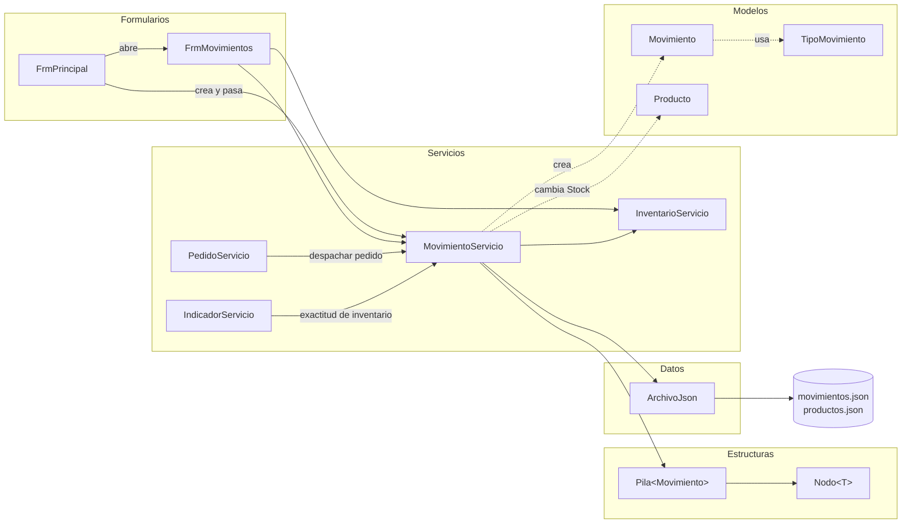
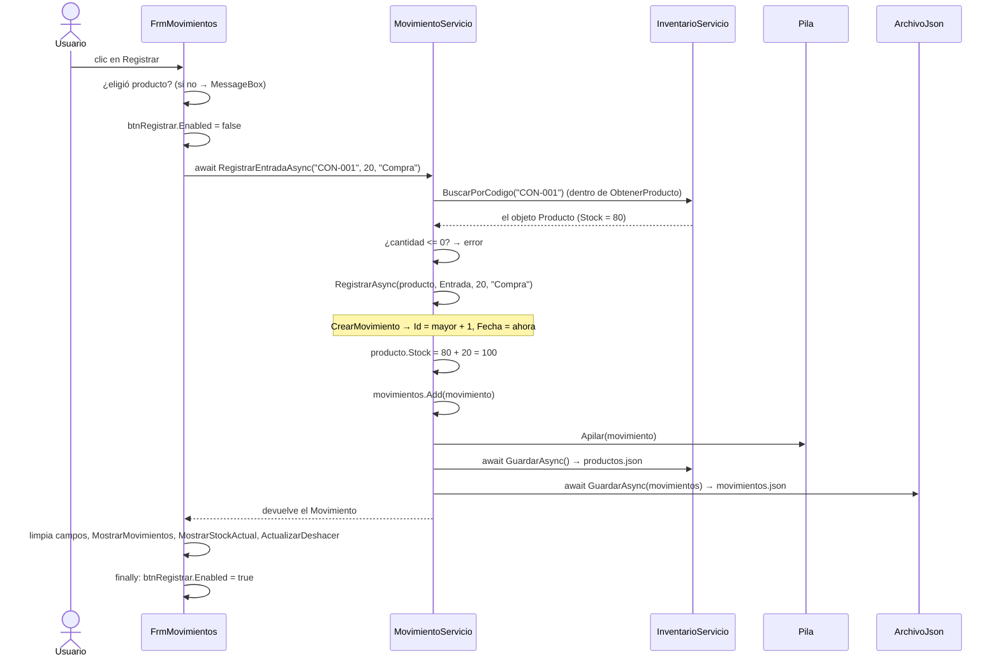
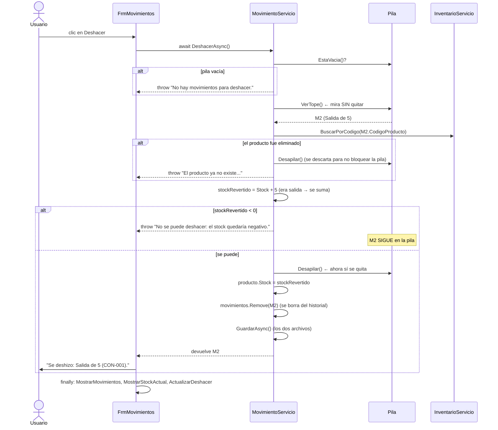

# Guía de estudio 2 — Formulario de Movimientos (`FrmMovimientos`)

> **Objetivo de esta guía:** que usted pueda explicar cómo se registra una entrada, una salida o un
> ajuste de inventario, cómo eso cambia el stock del producto y cómo funciona el botón **Deshacer**
> con la **pila** que hicimos a mano.
>
> Antes de esta guía conviene haber leído la [guía 1 (Productos)](01-FrmProductos.md), porque aquí se
> usa otra vez `InventarioServicio`.

---

## 1. ¿Qué hace esta pantalla?

Registra los **cambios de stock**. En la guía 1 vimos que el stock **no** se puede editar en
Productos: este es el único lugar donde el usuario lo cambia.

```
┌───────────────────────────────────────────────┬────────────────────────────────┐
│ N.º │ Fecha       │ Código │ Producto │ Tipo  │ REGISTRAR MOVIMIENTO           │
│  3  │ 2026-11-09  │ CON-001│ Cemento  │Salida │  Producto  [CON-001 - Cem.. ▼] │
│  2  │ 2026-11-09  │ CON-001│ Cemento  │Entrada│  Stock actual: 90 bulto        │
│  1  │ ...         │        │          │       │  Tipo      [Entrada ▼]         │
│ (el más reciente arriba)                      │  Cantidad  [  10  ]            │
│                                               │  Observación [          ]      │
│                                               │  [Registrar]                   │
│                                               │  [Deshacer último movimiento]  │
│  dgvMovimientos                               │  Movimientos para deshacer: 2  │
│                                               │  Se deshará: Salida de 5 (...) │
└───────────────────────────────────────────────┴────────────────────────────────┘
```

| Control | Para qué sirve |
|---|---|
| `dgvMovimientos` | Historial de movimientos, el más reciente arriba. |
| `cmbProducto` | Elegir el producto (muestra "código - nombre"). |
| `lblStockActual` | Muestra el stock del producto elegido. |
| `cmbTipo` | Entrada, Salida o Ajuste. |
| `nudCantidad` + `lblCantidad` | La cantidad. En un ajuste el texto cambia a "Conteo físico". |
| `txtObservacion` | Nota libre (ej. "Compra a proveedor X"). |
| `btnRegistrar` | Registra el movimiento. |
| `btnDeshacer`, `lblPila`, `lblSiguiente` | Deshacer y ver qué hay en la pila. |

### Los tres tipos de movimiento

| Tipo | Qué pasa en la vida real | Efecto en el stock | Qué se guarda en `Cantidad` |
|---|---|---|---|
| **Entrada** | Llega mercancía del proveedor. | `Stock + cantidad` | La cantidad que entró. |
| **Salida** | Se vende o se despacha. | `Stock − cantidad` | La cantidad que salió. |
| **Ajuste** | Se contó físicamente en bodega y no cuadra. | `Stock = conteo` | La **diferencia** `conteo − sistema` (puede ser negativa o cero). |

---

## 2. Archivos que participan (la "trazabilidad")

| Carpeta | Archivo | Papel en esta pantalla |
|---|---|---|
| `Formularios/` | `FrmPrincipal.cs` | Crea `MovimientoServicio` y abre `FrmMovimientos`. |
| `Formularios/` | `FrmMovimientos.cs` | Muestra el historial y captura el movimiento. |
| `Formularios/` | `FrmMovimientos.Designer.cs` | Crea los controles y conecta los eventos. |
| `Servicios/` | `MovimientoServicio.cs` | **La lógica**: validar, cambiar el stock, apilar, deshacer, guardar. |
| `Servicios/` | `InventarioServicio.cs` | Le presta los productos (`BuscarPorCodigo`) y guarda `productos.json`. |
| `Estructuras/` | `Pila.cs` | **Pila propia** (LIFO) para deshacer. |
| `Estructuras/` | `Nodo.cs` | El "eslabón" con el que se arma la pila. |
| `Modelos/` | `Movimiento.cs` | La "ficha" de un movimiento: Id, Fecha, Código, Tipo, Cantidad, Observación. |
| `Modelos/` | `TipoMovimiento.cs` | El `enum` con Entrada, Salida y Ajuste. |
| `Modelos/` | `Producto.cs` | Su propiedad `Stock` es la que cambia. |
| `Datos/` | `ArchivoJson.cs`, `RutasDatos.cs`, `DatosIniciales.cs` | Cargar y guardar `movimientos.json` (y `productos.json`). |
| `data/` | `movimientos.json`, `productos.json` | Se guardan **los dos** en cada movimiento. |
| `FerreStock.Pruebas/` | `MovimientoServicioPruebas.cs`, `PilaPruebas.cs` | Pruebas automáticas. |

### Diagrama de dependencias



**Fíjese en dos cosas:**

1. `MovimientoServicio` **depende de** `InventarioServicio` (lo recibe en su constructor). No tiene
   su propia lista de productos: usa la del inventario.
2. Este servicio también lo usan **otros dos servicios**: `PedidoServicio` (al despachar un pedido)
   e `IndicadorServicio` (para la exactitud de inventario). Es una pieza central del programa.

---

## 3. ¿Cómo llega el programa hasta esta pantalla?

```
FrmPrincipal_Load                                  (FrmPrincipal.cs:55)
   inventario  = new InventarioServicio();
   movimientos = new MovimientoServicio(inventario);   ← le pasa EL MISMO inventario
   pedidos     = new PedidoServicio(inventario, movimientos);
   ...
clic en "Movimientos" → AbrirMovimientos()           (FrmPrincipal.cs:117)
   new FrmMovimientos(inventario, movimientos).ShowDialog();
```

El **orden importa**: `MovimientoServicio` necesita un `InventarioServicio` ya creado, y
`PedidoServicio` necesita los dos. Por eso se crean en ese orden.

### El constructor del servicio

```csharp
// MovimientoServicio.cs:21
public MovimientoServicio(InventarioServicio inventario)
{
    this.inventario = inventario;
    movimientos = ArchivoJson.Cargar(RutasDatos.Movimientos, DatosIniciales.CrearMovimientos());
}
```

- Guarda la referencia al inventario compartido.
- Carga `movimientos.json`. Si no existe, la semilla es una **lista vacía** (al empezar no hay historial).
- La pila se crea vacía: `private readonly Pila<Movimiento> pilaDeshacer = new Pila<Movimiento>();`

> **Ojo:** la pila **no se guarda** en el JSON. Solo existe mientras el programa está abierto.
> Al cerrar y abrir de nuevo, el historial sigue ahí, pero ya no se puede deshacer nada.
> Es igual que el Ctrl+Z de Word: al cerrar el documento se pierde.

---

## 4. La estructura estrella: la Pila (`Pila<T>` con `Nodo<T>`)

### 4.1 ¿Qué es una pila?

Una pila es como una **pila de bultos de cemento**: el último que se pone encima es el primero que
se puede quitar. Esto se llama **LIFO** (*Last In, First Out*: último en entrar, primero en salir).

Para "deshacer" es exactamente lo que necesitamos: lo **último** que se hizo es lo **primero** que
se debe revertir.

### 4.2 ¿Cómo está hecha? (lista enlazada)

```csharp
public class Nodo<T>
{
    public T Valor { get; set; }              // el dato (aquí, un Movimiento)
    public Nodo<T>? Siguiente { get; set; }   // el nodo que está "debajo"
}
```

La pila solo guarda una referencia al nodo de **arriba** (`tope`). Cada nodo apunta al de abajo.

```
 Después de: Apilar(M1), Apilar(M2), Apilar(M3)

   tope
    │
    ▼
 ┌──────┐     ┌──────┐     ┌──────┐
 │  M3  │ ──► │  M2  │ ──► │  M1  │ ──► null
 └──────┘     └──────┘     └──────┘
  (último)                  (primero)
```

### 4.3 Las operaciones, paso a paso

**Apilar(M4)** (`Pila.cs`, método `Apilar`):

```
Paso 1: crear el nodo nuevo            [M4]
Paso 2: el nuevo apunta al tope actual [M4] ──► [M3] ──► [M2] ──► [M1]
Paso 3: el tope pasa a ser el nuevo    tope = [M4]
        Cantidad++
```

**Desapilar()**:

```
Paso 1: guardar el valor del tope       valor = M4
Paso 2: el tope baja al siguiente       tope = [M3]
        (el nodo [M4] queda sin referencias y .NET lo libera solo)
        Cantidad--
        devolver M4
```

**VerTope()**: devuelve el valor de arriba **sin quitarlo**. Se usa para mostrar
"Se deshará: ..." y para revisar si se puede deshacer antes de quitarlo.

| Operación | Qué hace | Complejidad |
|---|---|---|
| `Apilar(valor)` | Pone un valor arriba. | **O(1)** |
| `Desapilar()` | Quita y devuelve el de arriba. | **O(1)** |
| `VerTope()` | Mira el de arriba sin quitarlo. | **O(1)** |
| `EstaVacia()` | `tope == null`. | **O(1)** |

**¿Por qué O(1)?** Porque sin importar si la pila tiene 3 o 3.000 elementos, cada operación solo
cambia **una o dos referencias**. No se recorre nada ni se copia ningún arreglo.

**¿Por qué no usamos `Stack<T>` de .NET?** Porque la pila es una de las estructuras que se
**evalúan** en Estructura de Datos; el proyecto exige implementarla a mano (ver `CLAUDE.md`).

**¿Qué es la `<T>`?** Significa que la pila sirve para **cualquier tipo**. Aquí la usamos como
`Pila<Movimiento>`, pero en las pruebas se usa `Pila<int>`. La misma clase sirve para ambas.

---

## 5. Los eventos: qué método se ejecuta con cada acción

| Acción del usuario | Evento | Método del formulario | Método(s) del servicio que llama |
|---|---|---|---|
| Se abre la ventana | `Load` | `FrmMovimientos_Load` | `inventario.ObtenerProductos`, `movimientos.ObtenerRecientesPrimero`, `VerSiguienteParaDeshacer`, `CantidadParaDeshacer` |
| Elige un producto | `cmbProducto.SelectedIndexChanged` | `cmbProducto_SelectedIndexChanged` → `MostrarStockActual` | ninguno (lee `producto.Stock`) |
| Cambia el tipo | `cmbTipo.SelectedIndexChanged` | `cmbTipo_SelectedIndexChanged` | ninguno (cambia el texto a "Conteo físico") |
| Clic en "Registrar" | `btnRegistrar.Click` | `btnRegistrar_Click` | `RegistrarEntradaAsync` **o** `RegistrarSalidaAsync` **o** `RegistrarAjusteAsync` |
| Clic en "Deshacer" | `btnDeshacer.Click` | `btnDeshacer_Click` | `DeshacerAsync` |

### Los métodos "ayudantes" del formulario

| Método | Qué hace |
|---|---|
| `MostrarMovimientos()` | Llena la tabla con el historial (más reciente arriba). Para cada movimiento busca el nombre del producto con `inventario.BuscarPorCodigo`; si ya no existe muestra "(producto eliminado)". |
| `ActualizarDeshacer()` | Activa o desactiva el botón Deshacer según la pila, y muestra cuántos hay y cuál sigue. |
| `MostrarStockActual()` | Muestra el stock del producto elegido en el combo. |

> Después de **cada** registro o deshacer, el formulario llama los tres: `MostrarMovimientos()`,
> `MostrarStockActual()` y `ActualizarDeshacer()`. Así la pantalla siempre refleja los datos actuales.

### Detalle interesante: el combo guarda objetos `Producto` completos

```csharp
cmbProducto.DisplayMember = "Descripcion";      // lo que se VE: "CON-001 - Cemento gris 50 kg"
foreach (Producto p in inventario.ObtenerProductos())
{
    cmbProducto.Items.Add(p);                   // lo que se GUARDA: el objeto entero
}
```

`Descripcion` es la propiedad de `Producto` con `[JsonIgnore]` que vimos en la guía 1.
Como el combo guarda **el mismo objeto** que está en el inventario, cuando el servicio cambia
`producto.Stock`, el `lblStockActual` muestra el valor nuevo sin tener que buscar nada.

---

## 6. Recorridos completos (trazas) paso a paso

### 6.1 Registrar una **entrada**

El usuario elige "CON-001 - Cemento gris 50 kg" (stock 80), tipo Entrada, cantidad 20.



**Los 5 pasos comunes** están en un solo método privado, `RegistrarAsync`
(`MovimientoServicio.cs:198`), que comparten entrada, salida y ajuste:

```
1. Crear el movimiento     (CrearMovimiento)
2. Aplicar el stock        (Salida resta; Entrada y Ajuste suman)
3. Agregarlo al historial  (movimientos.Add)
4. Apilarlo para deshacer  (pilaDeshacer.Apilar)
5. Guardar                 (GuardarAsync → los DOS archivos)
```

Así no se repite el mismo código tres veces. Cada método público (`RegistrarEntradaAsync`, etc.)
solo hace **sus validaciones propias** y luego llama a `RegistrarAsync`.

**¿Por qué se guardan dos archivos?** Porque un movimiento cambia **dos cosas**: el historial
(`movimientos.json`) y el stock del producto (`productos.json`). Si solo se guardara uno, al
volver a abrir el programa el stock no cuadraría con el historial.

**¿Cómo se calcula el Id?** `SiguienteId()` recorre los movimientos, busca el Id **mayor** y le suma 1.
No se usa `movimientos.Count + 1` porque, si se deshizo un movimiento, podría repetirse un Id.

### 6.2 Registrar una **salida**

Igual que la entrada, pero `RegistrarSalidaAsync` (`MovimientoServicio.cs:79`) agrega una
validación más **antes** de tocar nada:

```csharp
if (cantidad > producto.Stock)
{
    throw new ArgumentException("Stock insuficiente de " + producto.Codigo + ": hay " + producto.Stock +
                                " y se quieren sacar " + cantidad + ".");
}
```

Si hay 80 bultos y se quieren sacar 100, el error se lanza y **no** se crea el movimiento, **no**
cambia el stock y **no** se apila nada. El stock nunca queda negativo.

### 6.3 Registrar un **ajuste** (conteo físico)

Este es el más interesante para la pregunta de investigación (*errores de inventario*).

Ejemplo: el sistema dice 80 bultos, pero al contar en la bodega hay **77**.

```
RegistrarAjusteAsync("CON-001", conteoFisico: 77, "Conteo mensual")
  ├─ ¿conteo < 0? → error
  ├─ diferencia = 77 − 80 = −3                ← faltaban 3 bultos
  ├─ detalle = "Sistema: 80, conteo: 77. Conteo mensual"
  └─ RegistrarAsync(producto, Ajuste, −3, detalle)
        └─ producto.Stock = 80 + (−3) = 77    ← queda igual al conteo
```

| Caso | Sistema | Conteo | Diferencia guardada | Significa |
|---|---|---|---|---|
| Faltaba mercancía | 80 | 77 | **−3** | Pérdida, robo o error de despacho. |
| Sobraba mercancía | 80 | 82 | **+2** | Entrada no registrada. |
| Todo cuadra | 80 | 80 | **0** | El inventario estaba **exacto**. |

**¿Por qué guardar la diferencia y no el conteo?** Por dos razones:

1. Con la diferencia, el ajuste funciona como una entrada "con signo": se **suma** al stock. Así
   `RegistrarAsync` y `DeshacerAsync` tratan entrada y ajuste igual.
2. `IndicadorServicio` usa esa diferencia para calcular la **exactitud de inventario**:

```csharp
// IndicadorServicio.cs — cuenta los ajustes y cuántos tuvieron diferencia 0
if (m.Tipo == TipoMovimiento.Ajuste)
{
    reporte.ConteosRealizados++;
    if (m.Cantidad == 0)
    {
        reporte.ConteosExactos++;
    }
}
// Exactitud (%) = 100 × ConteosExactos / ConteosRealizados
```

Así, los ajustes que se registran en **esta** pantalla alimentan un **indicador** en otra.

### 6.4 **Deshacer** el último movimiento

Supongamos que se hizo: Entrada de 20 (M1) y luego Salida de 5 (M2). La pila está así:

```
tope → [M2: Salida 5] → [M1: Entrada 20] → null
```

Al pulsar Deshacer se revierte **M2** (el último), no M1.



**La regla para revertir** (`MovimientoServicio.cs:166`):

| Lo que hizo el movimiento | Para deshacerlo |
|---|---|
| Entrada **sumó** la cantidad | se **resta** |
| Salida **restó** la cantidad | se **suma** |
| Ajuste **sumó** la diferencia (con signo) | se **resta** la diferencia |

**¿Por qué primero `VerTope()` y después `Desapilar()`?** Porque puede que **no** se pueda deshacer.
Ejemplo: se registró una entrada de 5, y después alguien sacó esos 5 por un pedido. Si se deshiciera
la entrada, el stock quedaría en −5. En ese caso se lanza el error y el movimiento **se queda en la
pila**. Si se hubiera usado `Desapilar()` de entrada, el movimiento se habría perdido sin revertirse.

> Regla general que vale para todo el proyecto: **primero validar, después modificar.**
> Así nunca quedan los datos "a medias".

**¿Por qué el `finally` refresca la pantalla aunque haya error?** Porque en el caso del producto
eliminado la pila **sí** cambió (se descartó el movimiento), aunque se haya lanzado un error.

---

## 7. Conexión con Pedidos: salidas que **no** se pueden deshacer

Cuando en la pantalla de Pedidos se **despacha** un pedido, `PedidoServicio.DespacharAsync` llama:

```csharp
await movimientos.RegistrarSalidasDePedidoAsync(pedido);   // PedidoServicio.cs
```

Este método (`MovimientoServicio.cs:117`) es distinto a una salida normal:

```
Paso 1: revisar TODOS los ítems del pedido → si alguno no tiene stock, error y no se toca nada.
Paso 2: por cada ítem, restar el stock y agregar una Salida al historial
        con la observación "Despacho del pedido N (cliente)".
Paso 3: guardar una sola vez al final.
```

Diferencias importantes:

| | Salida manual (esta pantalla) | Salida por despacho de pedido |
|---|---|---|
| ¿Quién la llama? | `FrmMovimientos` | `PedidoServicio` |
| ¿Va a la pila? | **Sí** | **No** |
| ¿Cuántos productos? | Uno | Todos los ítems del pedido |

**¿Por qué las del pedido no van a la pila?** Si se pudieran deshacer, el stock volvería a subir,
pero el pedido seguiría marcado como **Despachado**. Los datos dejarían de ser coherentes.

**¿Por qué "todo o nada"?** Para nunca despachar un pedido a medias: si hay cemento pero no hay
varilla, no sale nada.

Esas salidas sí aparecen en la tabla de esta pantalla, porque están en la misma lista `movimientos`.

---

## 8. Validaciones de esta pantalla

| Dónde | Regla | Mensaje |
|---|---|---|
| Formulario | Debe elegir un producto. | "Debe elegir un producto." |
| `ObtenerProducto` | El código debe existir. | "No existe un producto con el código ..." |
| Entrada / Salida | Cantidad mayor que cero. | "La cantidad de la entrada/salida debe ser mayor que cero." |
| Salida | No sacar más de lo que hay. | "Stock insuficiente de X: hay N y se quieren sacar M." |
| Ajuste | Conteo no negativo. | "El conteo físico no puede ser negativo." |
| Deshacer | La pila no puede estar vacía. | "No hay movimientos para deshacer." |
| Deshacer | El stock no puede quedar negativo. | "No se puede deshacer: el stock de X quedaría negativo." |

**Pregunta trampa:** ¿por qué el formulario valida "Debe elegir un producto" si la regla dice que
el formulario no valida? Porque esa no es una regla del negocio sino de la pantalla: sin producto
elegido, el formulario ni siquiera tiene un código que enviar. Además, el servicio **también** lo
revisa en `ObtenerProducto` (si el código viene vacío), así que la regla no depende del formulario.

---

## 9. Pruebas automáticas relacionadas

**`PilaPruebas.cs`** prueba la estructura sola, sin servicios ni archivos:

| Prueba | Qué demuestra |
|---|---|
| `PilaNueva_EstaVacia` | Una pila nueva no tiene elementos. |
| `Desapilar_DevuelveEnOrdenInverso` | LIFO: lo último que entra es lo primero que sale. |
| `VerTope_NoQuitaElElemento` | Mirar no es lo mismo que sacar. |
| `PilaVacia_DesapilarYVerTope_LanzanError` | No se puede sacar de una pila vacía. |
| `SePuedeReutilizarDespuesDeVaciarla` | Después de vaciarla sigue funcionando. |

**`MovimientoServicioPruebas.cs`** prueba la lógica con datos en una carpeta temporal:

```csharp
[Fact]
public async Task Deshacer_RevierteEnOrdenInverso()
{
    int antes = StockDe("CON-001");
    await servicio.RegistrarEntradaAsync("CON-001", 10, "");
    await servicio.RegistrarSalidaAsync("CON-001", 3, "");

    Movimiento primero = await servicio.DeshacerAsync();
    Assert.Equal(TipoMovimiento.Salida, primero.Tipo);      // se deshace primero la SALIDA
    Assert.Equal(antes + 10, StockDe("CON-001"));

    Movimiento segundo = await servicio.DeshacerAsync();
    Assert.Equal(TipoMovimiento.Entrada, segundo.Tipo);     // y luego la ENTRADA
    Assert.Equal(antes, StockDe("CON-001"));                // el stock vuelve al original
    Assert.Empty(servicio.ObtenerMovimientos());
    Assert.Equal(0, servicio.CantidadParaDeshacer());
}
```

Otra prueba importante: `Deshacer_SiElStockQuedariaNegativo_LanzaErrorYConservaLaPila` comprueba
que, si no se puede deshacer, el movimiento **sigue en la pila** (sección 6.4).

---

## 10. Preguntas probables de la sustentación (con respuesta)

**1. ¿Por qué usaron una pila para deshacer y no una cola?**
Porque deshacer debe revertir **lo último** que se hizo. Eso es LIFO (pila). Una cola es FIFO:
revertiría lo primero que se hizo, que no tiene sentido.

**2. ¿Por qué la pila es enlazada y no con arreglo?**
Porque apilar y desapilar solo cambian la referencia del tope: O(1) siempre, sin tener que
agrandar ni copiar un arreglo cuando se llena.

**3. ¿Qué complejidad tienen las operaciones de la pila?**
Apilar, Desapilar, VerTope y EstaVacia son O(1).

**4. Si cierro el programa, ¿puedo deshacer al volver a abrirlo?**
No. La pila vive solo en memoria. El historial sí queda guardado en `movimientos.json`.

**5. ¿Por qué no se puede editar el stock en Productos?**
Para que todo cambio quede registrado aquí como movimiento, con fecha y observación, y se pueda
auditar y deshacer.

**6. ¿Cómo se registra un conteo físico?**
Con un Ajuste: se escribe lo contado, el stock se iguala al conteo y se guarda la diferencia.
Con esas diferencias se calcula la exactitud de inventario.

**7. ¿Qué pasa si intento sacar más de lo que hay?**
`RegistrarSalidaAsync` lanza `ArgumentException("Stock insuficiente...")` antes de cambiar nada,
y el formulario lo muestra en un `MessageBox`.

**8. ¿Por qué cada movimiento guarda dos archivos?**
Porque cambia el historial y el stock del producto. Deben quedar los dos coherentes.

**9. ¿Por qué las salidas de un pedido despachado no se pueden deshacer?**
Porque el pedido quedaría marcado como despachado sin que la mercancía hubiera salido.

**10. ¿Por qué `MovimientoServicio` recibe a `InventarioServicio` en el constructor?**
Porque necesita los **mismos** productos que ven las demás pantallas. Si creara su propio
inventario, cambiaría el stock de una copia que nadie más ve.

---

## 11. Ejercicios para practicar

1. **Dibujar la pila.** Registre en el programa: Entrada 10, Salida 3, Ajuste a 50. Dibuje en papel
   cómo queda la pila (nodos y flechas) y qué stock queda después de cada Deshacer.
2. **Punto de interrupción.** Ponga un *breakpoint* en `Pila.Apilar` y otro en `Pila.Desapilar`.
   Registre dos movimientos y deshaga uno. Observe cómo cambia `tope` en la ventana de Variables.
3. **Caso del stock negativo.** Haga una entrada de 5 de un producto con stock 0, luego una salida de 5
   y después intente deshacer **dos** veces. Explique por qué la segunda vez sale error.
4. **Filtro** (`TODO estudiante` en `FrmMovimientos.cs`): agregar un filtro para ver solo los
   movimientos de un producto o de un tipo. Pista: ¿el filtro debería ir en el formulario o en
   `MovimientoServicio`? (Repase la sección 6.2 de la guía 1 sobre `Filtrar`.)
5. **Prueba nueva.** En `PilaPruebas.cs`, escriba una prueba que apile 1.000 números y verifique que
   `Cantidad` vale 1.000 y que el primero en salir es el último que entró.
6. **Pregunta de diseño.** ¿Qué tendría que cambiar para que la pila de deshacer sobreviviera al
   cerrar el programa? ¿Qué problemas traería?

---

## 12. Resumen en una frase

> **FrmMovimientos** captura el movimiento; **MovimientoServicio** valida, cambia el stock del
> **Producto** que le presta **InventarioServicio**, lo agrega al historial, lo **apila** en la
> **Pila** propia y guarda los dos archivos; **Deshacer** mira el tope, valida y solo entonces
> desapila y revierte.
