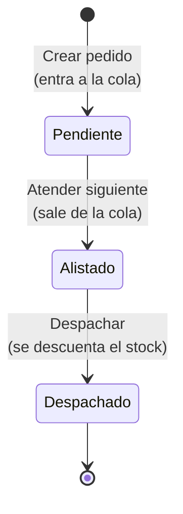
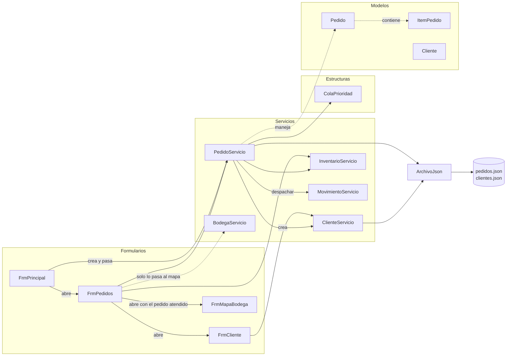
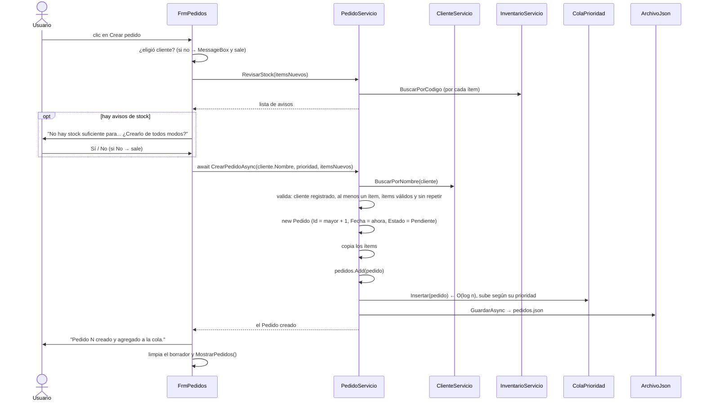
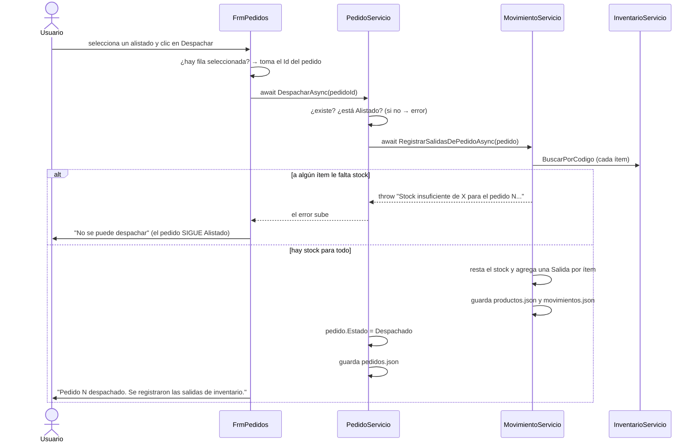

# Guía de estudio 3 — Formulario de Pedidos (`FrmPedidos`)

> **Objetivo de esta guía:** que usted pueda explicar cómo se arma un pedido, cómo la **cola de
> prioridad** (heap binario hecho a mano) decide cuál se atiende primero, y cómo un pedido pasa de
> *Pendiente* a *Alistado* y a *Despachado*.
>
> Conviene haber leído antes la [guía 1 (Productos)](01-FrmProductos.md) y la
> [guía 2 (Movimientos)](02-FrmMovimientos.md): al despachar un pedido se usa `MovimientoServicio`.

---

## 1. ¿Qué hace esta pantalla?

Es la pantalla con más conexiones del programa. Tiene tres zonas:

```
┌───────────────────────────┬──────────────────────────────────────────────────────┐
│ NUEVO PEDIDO              │ COLA DE ATENCIÓN (pendientes, en orden de prioridad) │
│ Cliente [ ▼ ][Nuevo cli.] │ Turno│Pedido│Cliente            │Prioridad│ Ítems   │
│ Prioridad [Mostrador ▼]   │  1   │  3   │Obra Calle 10      │Urgente  │CON-001..│
│ Producto  [ ▼ ]           │  2   │  1   │Constructora Andina│Mayorista│...      │
│ Cantidad  [ 1 ]           │  3   │  5   │...                │Mayorista│         │
│ [Agregar ítem]            │ Siguiente: pedido 3 de Obra Calle 10 (Urgente)       │
│ ┌──────────────────────┐  │ [Atender siguiente]                                  │
│ │Código │Producto│Cant.│  ├──────────────────────────────────────────────────────┤
│ │CON-001│Cemento │ 20  │  │ PEDIDOS ALISTADOS (listos para despachar)            │
│ └──────────────────────┘  │ Pedido│Cliente│Prioridad│Fecha│Ítems                 │
│ [Quitar ítem]             │                                                      │
│ [Crear pedido]            │ [Despachar seleccionado]          Despachados: 0     │
│  grpNuevo                 │  grpCola / grpAlistados                              │
└───────────────────────────┴──────────────────────────────────────────────────────┘
```

| Zona | Controles | Para qué sirve |
|---|---|---|
| Izquierda | `cmbCliente`, `btnNuevoCliente`, `cmbPrioridad`, `cmbProducto`, `nudCantidad`, `btnAgregarItem`, `dgvItems`, `btnQuitarItem`, `btnCrearPedido` | Armar un pedido nuevo. |
| Derecha arriba | `dgvCola`, `lblSiguiente`, `btnAtenderSiguiente` | Ver la cola y sacar el siguiente pedido. |
| Derecha abajo | `dgvAlistados`, `btnDespachar`, `lblDespachados` | Despachar los pedidos que ya se alistaron. |

### El ciclo de vida de un pedido



| Estado | Qué significa en la ferretería | ¿Está en la cola? | ¿Ya se descontó el stock? |
|---|---|---|---|
| **Pendiente** | El cliente pidió; nadie lo ha empezado. | **Sí** | No |
| **Alistado** | Un empleado lo está recogiendo en la bodega. | No | No |
| **Despachado** | La mercancía salió de la ferretería. | No | **Sí** |

---

## 2. Archivos que participan (la "trazabilidad")

| Carpeta | Archivo | Papel en esta pantalla |
|---|---|---|
| `Formularios/` | `FrmPrincipal.cs` | Crea los servicios y abre `FrmPedidos`. |
| `Formularios/` | `FrmPedidos.cs` | Arma el pedido, muestra la cola y los alistados. |
| `Formularios/` | `FrmCliente.cs` | Ventanita para registrar un cliente nuevo (botón "Nuevo cliente"). |
| `Formularios/` | `FrmMapaBodega.cs` | Se abre al atender un pedido, para ver la ruta de alistamiento. |
| `Servicios/` | `PedidoServicio.cs` | **La lógica**: crear, atender, despachar, validar. |
| `Servicios/` | `ClienteServicio.cs` | Clientes registrados (lo crea `PedidoServicio`). |
| `Servicios/` | `InventarioServicio.cs` | Para verificar que los productos existan y tengan stock. |
| `Servicios/` | `MovimientoServicio.cs` | Al despachar, genera las salidas de inventario. |
| `Servicios/` | `BodegaServicio.cs` | El formulario solo lo recibe para pasárselo al mapa. |
| `Estructuras/` | `ColaPrioridad.cs` | **Heap binario mínimo propio** que ordena los pendientes. |
| `Modelos/` | `Pedido.cs`, `ItemPedido.cs` | El pedido y cada una de sus líneas. |
| `Modelos/` | `PrioridadPedido.cs` | `enum`: Urgente = 1, Mayorista = 2, Mostrador = 3. |
| `Modelos/` | `EstadoPedido.cs` | `enum`: Pendiente, Alistado, Despachado. |
| `Modelos/` | `Cliente.cs` | Documento, nombre y teléfono del cliente. |
| `Datos/` | `ArchivoJson.cs`, `RutasDatos.cs`, `DatosIniciales.cs` | Cargar y guardar `pedidos.json` (y `clientes.json`). |
| `data/` | `pedidos.json`, `clientes.json` | Los datos en disco. |
| `FerreStock.Pruebas/` | `ColaPrioridadPruebas.cs`, `PedidoServicioPruebas.cs` | Pruebas automáticas. |

### Diagrama de dependencias



**Fíjese:**

1. `PedidoServicio` es el servicio que **más depende de otros**: usa inventario, movimientos, clientes
   y la cola. Por eso en `FrmPrincipal` se crea **después** de `InventarioServicio` y `MovimientoServicio`.
2. `FrmPedidos` recibe `BodegaServicio` aunque no lo usa directamente: lo necesita para poder abrir
   `FrmMapaBodega`, que sí lo usa.
3. `ClienteServicio` **no** lo crea `FrmPrincipal`, sino `PedidoServicio` en su constructor, porque
   solo el módulo de pedidos lo necesita. El formulario lo alcanza con `pedidos.Clientes`.

---

## 3. ¿Cómo llega el programa hasta esta pantalla?

```
FrmPrincipal_Load                                    (FrmPrincipal.cs:55)
   inventario  = new InventarioServicio();
   movimientos = new MovimientoServicio(inventario);
   pedidos     = new PedidoServicio(inventario, movimientos);    ← necesita los dos
   bodega      = new BodegaServicio(inventario);
clic en "Pedidos" → AbrirPedidos()                    (FrmPrincipal.cs:130)
   new FrmPedidos(inventario, pedidos, bodega).ShowDialog();
```

### El constructor de `PedidoServicio`: la cola se **reconstruye**

```csharp
// PedidoServicio.cs:28
public PedidoServicio(InventarioServicio inventario, MovimientoServicio movimientos)
{
    this.inventario = inventario;
    this.movimientos = movimientos;
    Clientes = new ClienteServicio();                       // carga clientes.json
    pedidos = ArchivoJson.Cargar(RutasDatos.Pedidos, DatosIniciales.CrearPedidos());

    // La cola no se guarda en el archivo: se reconstruye con los pedidos pendientes.
    foreach (Pedido p in pedidos)
    {
        if (p.Estado == EstadoPedido.Pendiente)
        {
            cola.Insertar(p);
        }
    }
}
```

**¿Por qué la cola no se guarda en el JSON?** Porque no hace falta: el `Estado` de cada pedido ya
dice cuáles están pendientes, y la `Prioridad` y la `Fecha` dicen en qué orden van. Con esos datos
la cola se puede volver a armar siempre igual. Guardar la cola sería guardar la misma información
dos veces (y podrían quedar diferentes).

> Compare con la pila de Movimientos (guía 2): la pila **se pierde** al cerrar, porque no hay forma
> de saber qué se podía deshacer. La cola, en cambio, **se reconstruye**, porque sí hay forma.

---

## 4. La estructura estrella: la Cola de prioridad (`ColaPrioridad`)

### 4.1 ¿Qué es una cola de prioridad?

Una cola normal (FIFO) atiende en orden de llegada, como la fila del banco. Una **cola de
prioridad** atiende primero al **más importante**, aunque haya llegado después, como la sala de
urgencias de un hospital.

La regla de FerreStock está en un solo método:

```csharp
// ColaPrioridad.cs:38 — ¿el pedido a debe atenderse antes que b?
public static bool VaAntes(Pedido a, Pedido b)
{
    if (a.Prioridad != b.Prioridad)
    {
        return a.Prioridad < b.Prioridad;   // 1. menor número de prioridad primero
    }
    if (a.Fecha != b.Fecha)
    {
        return a.Fecha < b.Fecha;           // 2. a igual prioridad, el más antiguo
    }
    return a.Id < b.Id;                     // 3. mismo momento: el de Id menor
}
```

Por eso el `enum` tiene números: `Urgente = 1`, `Mayorista = 2`, `Mostrador = 3`. Un número
**menor** se atiende **antes**. Como el "mejor" es el **mínimo**, se usa un **heap mínimo**.

### 4.2 ¿Qué es un heap binario?

Es un **árbol binario** que cumple una sola regla:

> **Cada padre va antes que sus hijos.**

Eso garantiza que en la **raíz** siempre está el pedido que se debe atender primero. Ojo: los
hermanos **no** tienen que estar ordenados entre sí; solo cada padre respecto a sus hijos.

El árbol **no** se hace con nodos y referencias (como la pila), sino **dentro de un arreglo**:

```
 Posición en el arreglo:   0     1     2     3     4
                         [ P3 ][ P5 ][ P1 ][ P4 ][ P2 ]

 El mismo arreglo visto como árbol:

                    P3 (Urgente)            ← posición 0 (raíz)
                  /              \
         P5 (Mayorista)      P1 (Mayorista)  ← posiciones 1 y 2
           /        \
   P4 (Mostrador)  P2 (Mostrador)            ← posiciones 3 y 4
```

Fórmulas para moverse en el árbol **sin referencias**, solo con aritmética:

| Quiero ir a... | Fórmula | Ejemplo con i = 1 (P5) |
|---|---|---|
| Hijo izquierdo | `2·i + 1` | 3 → P4 |
| Hijo derecho | `2·i + 2` | 4 → P2 |
| Padre | `(i − 1) / 2` (división entera) | 0 → P3 |

**¿Por qué un arreglo y no nodos?** Porque el árbol siempre está **completo** (se llena nivel por
nivel, de izquierda a derecha), así que no quedan huecos y cada posición tiene un lugar fijo.
Es más simple y ocupa menos memoria.

Si el arreglo se llena, `Insertar` crea uno del **doble** de tamaño y copia los elementos
(empieza con 8 posiciones). Esto pasa pocas veces.

### 4.3 Insertar: poner al final y **subir**

Vamos a usar los 5 pedidos de ejemplo de `DatosIniciales` (horas del 20 de octubre):

| Pedido | Cliente | Prioridad | Hora |
|---|---|---|---|
| P1 | Constructora Andina | Mayorista (2) | 8:15 |
| P2 | Juan Pérez | Mostrador (3) | 9:00 |
| P3 | Obra Calle 10 | **Urgente (1)** | 9:30 |
| P4 | María Gómez | Mostrador (3) | 10:10 |
| P5 | Ferretería El Tornillo | Mayorista (2) | 10:45 |

Algoritmo de `Insertar` (`ColaPrioridad.cs:53`):

```
Paso 1: si el arreglo está lleno, duplicarlo.
Paso 2: poner el pedido en la primera posición libre (al final).
Paso 3: Subir: mientras el pedido vaya antes que su padre, intercambiarlos.
```

Traza completa:

```
Insertar P1 (May 8:15)   [P1]                          nada que subir

Insertar P2 (Mos 9:00)   [P1, P2]                      ¿P2 va antes que P1 (padre)? No → queda

Insertar P3 (Urg 9:30)   [P1, P2, P3]                  ¿P3 va antes que P1? SÍ (1 < 2) → intercambiar
                         [P3, P2, P1]                  llegó a la raíz → para

Insertar P4 (Mos 10:10)  [P3, P2, P1, P4]              padre de 3 es 1 (P2). ¿P4 antes que P2?
                                                       Misma prioridad, P4 es más nuevo → No → queda

Insertar P5 (May 10:45)  [P3, P2, P1, P4, P5]          padre de 4 es 1 (P2). ¿P5 antes que P2? SÍ (2 < 3)
                         [P3, P5, P1, P4, P2]          padre de 1 es 0 (P3). ¿P5 antes que P3? No → para
```

Resultado: el árbol de la sección 4.2. Fíjese que **P1** (Mayorista de las 8:15) quedó a la derecha
y **P5** (Mayorista de las 10:45) a la izquierda: los hermanos no están ordenados, y no importa.

### 4.4 Extraer el mínimo: sacar la raíz y **bajar**

Algoritmo de `ExtraerMinimo` (`ColaPrioridad.cs:85`):

```
Paso 1: guardar la raíz (es el que se va a atender).
Paso 2: poner el ÚLTIMO elemento en la raíz y acortar el arreglo.
Paso 3: Bajar: mientras algún hijo vaya antes, intercambiar con el MEJOR de los dos hijos.
```

Traza al pulsar "Atender siguiente" con la cola anterior:

```
Inicio:                [P3, P5, P1, P4, P2]
Paso 1: mínimo = P3    (el Urgente)
Paso 2: el último (P2) pasa a la raíz
                       [P2, P5, P1, P4]
Paso 3: Bajar desde 0. Hijos: P5 (pos 1) y P1 (pos 2).
        ¿P5 antes que P2? Sí → mejor = P5
        ¿P1 antes que P5? Sí (misma prioridad, P1 es de las 8:15) → mejor = P1
        Intercambiar P2 con P1
                       [P1, P5, P2, P4]
        P2 quedó en pos 2; sus hijos serían 5 y 6, que no existen → para.
```

Ahora en la raíz está **P1**: el Mayorista más antiguo. Si se sigue extrayendo, el orden de
atención completo es:

```
P3 (Urgente) → P1 (Mayorista 8:15) → P5 (Mayorista 10:45) → P2 (Mostrador 9:00) → P4 (Mostrador 10:10)
```

Que es exactamente lo que comprueba la prueba `Cola_OrdenaPorPrioridadYLuegoPorFecha`.

**¿Por qué se intercambia con el *mejor* de los dos hijos?** Porque ese hijo va a quedar como padre
del otro. Si se subiera el peor, quedaría encima de uno que va antes que él y se rompería la regla.

### 4.5 Complejidad y por qué no una lista ordenada

| Operación | Heap binario | Lista ordenada | Lista sin ordenar |
|---|---|---|---|
| Insertar | **O(log n)** | O(n) (correr elementos) | O(1) |
| Ver el siguiente | **O(1)** | O(1) | O(n) (buscarlo) |
| Extraer el siguiente | **O(log n)** | O(1) o O(n) | O(n) |

Subir y Bajar recorren a lo sumo **la altura del árbol**, que es log₂(n) porque el árbol está
completo. Con 1.000 pedidos, la altura es apenas ~10. El heap es el mejor **equilibrio** entre
insertar y extraer.

**¿Por qué no usar `PriorityQueue` de .NET?** Porque la cola de prioridad es una de las estructuras
que se **evalúan**; el proyecto exige hacerla a mano (ver `CLAUDE.md`).

### 4.6 Mostrar la cola en orden sin dañarla

La tabla `dgvCola` muestra **todos** los pendientes en orden de turno. Pero el arreglo del heap no
está ordenado (vea `[P3, P5, P1, P4, P2]`). ¿Cómo se obtiene el orden?

```csharp
// ColaPrioridad.cs:112
public List<Pedido> ObtenerEnOrdenDeAtencion()
{
    ColaPrioridad copia = new ColaPrioridad();       // 1. una cola nueva
    for (int i = 0; i < Cantidad; i++)
    {
        copia.Insertar(elementos[i]);                // 2. se copian los pedidos
    }
    List<Pedido> resultado = new List<Pedido>();
    while (!copia.EstaVacia())
    {
        resultado.Add(copia.ExtraerMinimo());        // 3. se extraen de la COPIA uno por uno
    }
    return resultado;
}
```

Se extrae de una **copia** para no vaciar la cola real. Cuesta O(n log n), suficiente para mostrar
una tabla.

---

## 5. Los eventos: qué método se ejecuta con cada acción

| Acción del usuario | Método del formulario | Método(s) del servicio que llama |
|---|---|---|
| Se abre la ventana | `FrmPedidos_Load` | `pedidos.Clientes.ObtenerClientes`, `inventario.ObtenerProductos`, luego `MostrarPedidos` |
| Clic en "Nuevo cliente" | `btnNuevoCliente_Click` | abre `FrmCliente` → `ClienteServicio.AgregarClienteAsync` |
| Clic en "Agregar ítem" | `btnAgregarItem_Click` | `pedidos.AgregarItem` |
| Clic en "Quitar ítem" | `btnQuitarItem_Click` | ninguno (quita de la lista local) |
| Clic en "Crear pedido" | `btnCrearPedido_Click` | `pedidos.RevisarStock`, luego `pedidos.CrearPedidoAsync` |
| Clic en "Atender siguiente" | `btnAtenderSiguiente_Click` | `pedidos.AtenderSiguienteAsync`; puede abrir `FrmMapaBodega` |
| Clic en "Despachar seleccionado" | `btnDespachar_Click` | `pedidos.DespacharAsync` → `MovimientoServicio.RegistrarSalidasDePedidoAsync` |

### Los métodos "ayudantes" del formulario

| Método | Qué hace |
|---|---|
| `CargarClientes()` | Llena el combo de clientes y lo deja **sin selección**, para obligar a escoger. |
| `MostrarItemsNuevos()` | Muestra en `dgvItems` los ítems del pedido que se está armando. |
| `MostrarPedidos()` | Llena la cola (con número de **Turno**), los alistados, el texto "Siguiente: ..." y el conteo de despachados. |
| `DescribirItems(pedido)` | Arma un texto corto como `"CON-001 x20, CON-006 x30"`. |
| `NombreProducto(codigo)` | Busca el nombre en el inventario, o "(no existe)". |

---

## 6. Recorridos completos (trazas) paso a paso

### 6.1 Armar el pedido: la lista `itemsNuevos`

Mientras el usuario agrega productos, el pedido **todavía no existe**. Los ítems se guardan en una
lista del **formulario**:

```csharp
// FrmPedidos.cs:17
private readonly List<ItemPedido> itemsNuevos = new List<ItemPedido>();
```

Al pulsar "Agregar ítem":

```
btnAgregarItem_Click
 ├─ producto = cmbProducto.SelectedItem as Producto   (null si no eligió)
 ├─ pedidos.AgregarItem(itemsNuevos, codigo, cantidad)
 │     ├─ ValidarItem: ¿el producto existe? ¿cantidad > 0?   → si no, ArgumentException
 │     ├─ si el producto YA está en la lista → suma la cantidad
 │     └─ si no → agrega un ItemPedido nuevo
 ├─ nudCantidad.Value = 1
 └─ MostrarItemsNuevos()
```

**Detalle importante:** la lista vive en el **formulario**, pero quien la modifica es el
**servicio**. Esto funciona porque una `List` se pasa **por referencia**: el servicio recibe la
**misma** lista, no una copia. Así la regla "si el producto se repite, sumar la cantidad" queda en
el servicio (y se puede probar), aunque los datos estén en el formulario.

Ejemplo: agregar CON-001 x 20 y luego CON-001 x 5 deja **una sola línea** con CON-001 x 25.

"Quitar ítem" sí lo hace el formulario directamente (`itemsNuevos.RemoveAt(...)`), porque no hay
ninguna regla del negocio que revisar: solo se quita una línea de un borrador.

### 6.2 Crear el pedido



Puntos para la sustentación:

- **El stock se revisa, pero no se descuenta.** `RevisarStock` solo **avisa**: el pedido se puede
  crear igual, porque la mercancía puede llegar antes de despacharlo. El stock se descuenta
  **solo al despachar** (sección 6.4).
- **Solo clientes registrados.** El combo está en modo `DropDownList` (no deja escribir) y además el
  servicio vuelve a revisar con `Clientes.BuscarPorNombre`. Doble seguridad.
- **Se copian los ítems** al pedido. Si se guardara la misma lista `itemsNuevos`, al limpiar el
  borrador (`itemsNuevos.Clear()`) ¡el pedido se quedaría sin ítems! (Es el efecto de la
  referencia que vimos en 6.1, ahora jugando en contra.)
- **Un Urgente nuevo no pasa por encima de un Urgente más antiguo.** Si se crea un pedido Urgente,
  queda de **segundo** detrás de P3 (prueba `CrearPedido_UrgenteNuevo_PasaDeSegundoEnLaCola`).

### 6.3 Atender el siguiente

```
btnAtenderSiguiente_Click
 ├─ atendido = await pedidos.AtenderSiguienteAsync()
 │     ├─ ¿cola vacía? → ArgumentException("No hay pedidos pendientes.")
 │     ├─ pedido = cola.ExtraerMinimo()           ← O(log n), sección 4.4
 │     ├─ pedido.Estado = Alistado
 │     └─ GuardarAsync()                           ← pedidos.json
 ├─ MostrarPedidos()                               ← el pedido pasa de la tabla de cola a la de alistados
 └─ "¿Ver la ruta de alistamiento en el mapa?"
       └─ Sí → new FrmMapaBodega(bodega, pedidos, atendido).ShowDialog()
```

Fíjese que el usuario **no elige** cuál pedido atender: lo decide la cola. Esa es justamente la
"priorización de pedidos" de la **pregunta de investigación**.

Aquí **todavía no se toca el stock**: alistar es recoger la mercancía en la bodega, no sacarla de
la ferretería.

**Conexión con el mapa:** el pedido atendido se le pasa a `FrmMapaBodega` por el constructor, y el
mapa dibuja la ruta más corta (Dijkstra sobre el grafo de la bodega) para recoger sus productos.
Eso se explica en la guía del Mapa de bodega.

### 6.4 Despachar



**¿Por qué `PedidoServicio` no resta el stock él mismo?** Porque **toda** modificación del stock
debe pasar por `MovimientoServicio`, para que quede en el historial. Si cada servicio cambiara
`producto.Stock` por su cuenta, el historial dejaría de cuadrar con el stock.

**¿Por qué el estado cambia *después* de las salidas?** Si fallan las salidas (falta stock), el
error se lanza antes de llegar a `pedido.Estado = Despachado`, así que el pedido **sigue Alistado**
y se puede intentar de nuevo cuando llegue la mercancía. Otra vez: **primero validar, después modificar**.

Recuerde de la guía 2 (sección 7) que estas salidas **no** van a la pila de deshacer y que se
revisan **todos** los ítems antes de descontar ninguno (todo o nada).

---

## 7. Validaciones de esta pantalla

| Dónde | Regla | Mensaje |
|---|---|---|
| Formulario | Elegir un cliente. | "Seleccione el cliente. Si no aparece en la lista, regístrelo con 'Nuevo cliente'." |
| Formulario | Elegir el ítem a quitar. | "Seleccione el ítem que quiere quitar." |
| Formulario | Elegir el pedido a despachar. | "Seleccione el pedido alistado que quiere despachar." |
| `ValidarItem` | El producto debe existir. | "Debe elegir un producto que exista." |
| `ValidarItem` | Cantidad mayor que cero. | "La cantidad debe ser mayor que cero." |
| `CrearPedidoAsync` | Cliente registrado. | "El cliente X no está registrado. Regístrelo primero..." |
| `CrearPedidoAsync` | Al menos un ítem. | "El pedido debe tener al menos un producto." |
| `CrearPedidoAsync` | Sin productos repetidos. | "El producto X está repetido en el pedido." |
| `RevisarStock` | Stock suficiente (**solo aviso**). | "No hay stock suficiente para... ¿Crearlo de todos modos?" |
| `AtenderSiguienteAsync` | Cola no vacía. | "No hay pedidos pendientes." |
| `DespacharAsync` | Solo pedidos Alistados. | "Solo se pueden despachar pedidos alistados..." |
| `RegistrarSalidasDePedidoAsync` | Stock para **todos** los ítems. | "Stock insuficiente de X para el pedido N..." |

### Reglas que protegen a los pedidos desde otras pantallas

`PedidoServicio` también tiene métodos que usan **otros formularios** para no dañar los pedidos:

| Método | Lo usa | Impide |
|---|---|---|
| `ValidarEliminacionProducto` | `FrmProductos` (guía 1, sección 6.6) | Borrar un producto que está en un pedido sin despachar. |
| `ValidarEliminacionCliente` / `EliminarClienteAsync` | Pantalla de clientes | Borrar un cliente con pedidos sin despachar. |
| `EditarClienteAsync` | Pantalla de clientes | Si cambia el nombre del cliente, lo cambia también en sus pedidos. |

---

## 8. Cómo queda un pedido en `data/pedidos.json`

```json
{
  "Id": 3,
  "Fecha": "2026-10-20T09:30:00",
  "Cliente": "Obra Calle 10",
  "Prioridad": "Urgente",
  "Items": [
    { "CodigoProducto": "CON-001", "Cantidad": 10 },
    { "CodigoProducto": "CON-004", "Cantidad": 1 }
  ],
  "Estado": "Pendiente"
}
```

- `Prioridad` y `Estado` se guardan como **texto** (no como 1 o 0) gracias al
  `JsonStringEnumConverter` de `ArchivoJson`. Así el archivo se entiende al leerlo.
- `Items` es una **lista dentro del objeto**: el JSON permite guardar objetos anidados.
- El ítem guarda solo el **código** del producto, no el producto entero. Por eso hay que impedir
  borrar productos que estén en pedidos activos.
- La propiedad `Descripcion` de `Pedido` no aparece: tiene `[JsonIgnore]`.

---

## 9. Pruebas automáticas relacionadas

**`ColaPrioridadPruebas.cs`** — la estructura sola:

| Prueba | Qué demuestra |
|---|---|
| `ColaNueva_EstaVacia` | Extraer o ver de una cola vacía lanza error. |
| `Extraer_AtiendePrimeroElDeMayorPrioridad` | Urgente → Mayorista → Mostrador, aunque se insertaron al revés. |
| `AIgualPrioridad_AtiendePrimeroElMasAntiguo` | El desempate por fecha. |
| `MuchosPedidos_SalenSiempreEnOrden` | 200 pedidos al azar: el arreglo crece y el orden se mantiene. |
| `ObtenerEnOrdenDeAtencion_NoModificaLaCola` | Mostrar la cola no la vacía (sección 4.6). |

**`PedidoServicioPruebas.cs`** — la lógica completa:

| Prueba | Qué demuestra |
|---|---|
| `Cola_OrdenaPorPrioridadYLuegoPorFecha` | Con los datos iniciales el orden es 3, 1, 5, 2, 4 (sección 4.4). |
| `CrearPedido_UrgenteNuevo_PasaDeSegundoEnLaCola` | Un Urgente nuevo queda detrás del Urgente más antiguo. |
| `AgregarItem_ProductoRepetido_SumaLaCantidad` | La regla de la sección 6.1. |
| `CrearPedido_ClienteNoRegistrado_LanzaErrorYNoCreaNada` | Solo clientes registrados. |
| `AtenderSiguiente_SacaElUrgenteYLoMarcaAlistado` | Extraer + cambio de estado. |
| `Despachar_DescuentaElStockYRegistraSalidas` | La conexión con `MovimientoServicio`. |
| `Despachar_SinStock_NoDescuentaNadaYSigueAlistado` | Todo o nada. |
| `AlReabrir_LaColaSoloTieneLosPendientes` | La cola se reconstruye al abrir (sección 3). |

---

## 10. Preguntas probables de la sustentación (con respuesta)

**1. ¿Por qué usaron una cola de prioridad y no una cola normal?**
Porque los pedidos no se atienden en orden de llegada: un Urgente debe pasar antes que uno de
Mostrador que llegó primero. Solo a igual prioridad se respeta el orden de llegada.

**2. ¿Qué es un heap binario mínimo?**
Un árbol binario completo, guardado en un arreglo, donde cada padre va antes que sus hijos.
Así el siguiente pedido a atender siempre está en la posición 0.

**3. ¿Cómo encuentran el padre y los hijos sin referencias?**
Hijos de `i`: `2i + 1` y `2i + 2`. Padre de `i`: `(i − 1) / 2`.

**4. ¿Qué complejidad tienen insertar y extraer?**
O(log n), porque Subir y Bajar recorren a lo sumo la altura del árbol, que es log₂(n).
Ver el siguiente es O(1).

**5. ¿Por qué es un heap *mínimo* y no máximo?**
Porque Urgente vale 1: el **menor** número es el más importante.

**6. Si cierro el programa, ¿se pierde la cola?**
No. La cola no se guarda, pero se **reconstruye** al abrir, insertando los pedidos con estado Pendiente.

**7. ¿Cuándo se descuenta el stock: al crear, al alistar o al despachar?**
Solo al **despachar**, y lo hace `MovimientoServicio` para que quede en el historial.

**8. ¿Qué pasa si al despachar falta un producto?**
No se despacha nada (todo o nada) y el pedido sigue Alistado.

**9. ¿Dónde cambiarían el criterio de desempate?**
Solo en `ColaPrioridad.VaAntes`. Es el único lugar donde está la regla.

**10. ¿Por qué `FrmPedidos` recibe `BodegaServicio` si no lo usa?**
Para pasárselo a `FrmMapaBodega` cuando se atiende un pedido y se quiere ver la ruta.

**11. ¿Por qué se copian los ítems al crear el pedido?**
Porque el formulario limpia su lista `itemsNuevos` después de crear el pedido; si el pedido
guardara la misma lista, quedaría vacío.

---

## 11. Ejercicios para practicar

1. **Heap en papel.** Inserte en orden estos pedidos en un heap vacío y dibuje el arreglo y el árbol
   después de cada inserción: Mostrador 8:00, Mostrador 8:30, Mayorista 9:00, Urgente 9:15,
   Mayorista 9:20, Urgente 9:40. Luego haga **dos** extracciones y dibuje el resultado.
2. **Verificar con el programa.** Cree esos mismos pedidos en la pantalla y compare la columna
   **Turno** con el orden que obtuvo en papel.
3. **Punto de interrupción.** Ponga un *breakpoint* en `ColaPrioridad.Bajar` y pulse "Atender
   siguiente". Observe `izquierdo`, `derecho` y `mejor` en cada vuelta del `while`.
4. **Nuevo criterio** (`TODO estudiante` en `ColaPrioridad.VaAntes`): a igual prioridad y fecha,
   atender primero el pedido con **menos ítems**. Agregue una prueba en `ColaPrioridadPruebas.cs`.
5. **Pregunta de diseño.** ¿Qué pasaría si `AtenderSiguienteAsync` descontara el stock en vez de
   `DespacharAsync`? Piense en un pedido que se alista y luego el cliente cancela.
6. **Rastreo completo.** Escriba en orden todos los métodos (de todas las clases) que se ejecutan
   desde que se pulsa "Despachar seleccionado" hasta que aparece el mensaje de éxito. Incluya los
   de `MovimientoServicio`, `InventarioServicio` y `ArchivoJson`. ¿Cuántos archivos JSON se escriben?

---

## 12. Resumen en una frase

> **FrmPedidos** arma el pedido y muestra la cola; **PedidoServicio** valida y crea el pedido como
> *Pendiente* y lo mete en la **ColaPrioridad** (heap mínimo); **Atender** extrae el más prioritario
> y lo marca *Alistado* (y puede abrir el mapa con su ruta); **Despachar** le pide a
> **MovimientoServicio** las salidas de stock (todo o nada) y solo entonces lo marca *Despachado*.
