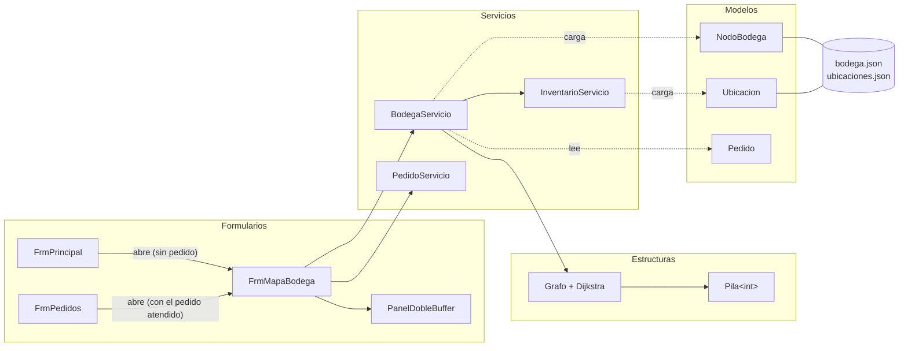

# Guía de estudio 4 — Mapa de bodega (`FrmMapaBodega`)

> **Objetivo de esta guía:** que usted pueda explicar cómo se representa la bodega como un **grafo**,
> cómo **Dijkstra** encuentra el camino más corto, cómo se arma la **ruta de alistamiento** de un
> pedido y cómo se **dibuja** todo en la pantalla con GDI+.
>
> Conviene haber leído antes la [guía 2 (Movimientos)](02-FrmMovimientos.md), porque aquí se
> reutiliza la **pila**, y la [guía 3 (Pedidos)](03-FrmPedidos.md), porque el mapa recibe un pedido.

---

## 1. ¿Qué hace esta pantalla?

Dibuja el plano de la bodega y, cuando se elige un pedido, muestra **por dónde debe caminar el
bodeguero** para recoger todos sus productos y volver al mostrador.

```
┌──────────────────────────────────────────────────────────┬─────────────────────────────┐
│                                                          │ Pedido [Pedido 3 - Obra.. ▼]│
│   Zona E          Zona E          Zona F         Zona F  │ Distancia: 56,9 m           │
│   [E-01]          [E-02]          [F-01]         [F-02]  │ Tiempo estimado: 2,2 min    │
│  9 ●────────── 10 ●──────────11 ●──────────12 ●          │ Paradas:                    │
│    │              │              │              │        │  1. Nodo 4 → D-01-1: CON-001│
│  5 ●────────── 6 ●────────── 7 ●────────── 8 ②  [D-03] │  2. Nodo 8 → D-03-1: CON-004│
│   [A-02]          [B-02]          [C-02]         [D-02]  │  Regreso al mostrador       │
│   [A-01]          [B-01]          [C-01]        [D-01]▓  │ ☐ Mostrar número de nodos   │
│  1 ●══════════ 2 ●══════════ 3 ●══════════ 4 ①          │                             │
│   ║                                                      │ Gris: pasillos. Azul: ruta..│
│ ● Mostrador                                              │                             │
│  pnlMapa (PanelDobleBuffer)                              │  pnlLateral                 │
└──────────────────────────────────────────────────────────┴─────────────────────────────┘
```

| Control | Para qué sirve |
|---|---|
| `pnlMapa` (`PanelDobleBuffer`) | Lienzo donde se dibuja el plano. |
| `cmbPedido` | Elegir un pedido sin despachar (pendientes en orden de cola, luego alistados). |
| `lblDistancia`, `lblTiempo` | Metros a caminar y minutos estimados. |
| `lstParadas` | Las paradas en orden: qué se recoge en cada una. |
| `lblSinUbicacion` | Productos del pedido que no tienen ubicación (no entran en la ruta). |
| `chkNumeros` | Mostrar u ocultar el número de cada nodo. |
| `lblLeyenda` | Explica los colores. |

Colores del dibujo: **gris** = pasillos, **naranja** = estantes donde hay que recoger algo,
**azul continuo** = ida, **azul punteado** = regreso, **círculo rojo** = mostrador,
**círculo azul con número** = orden de cada parada.

**Esta pantalla responde directamente la pregunta de investigación**: integra la *ubicación
espacial* de los productos para reducir el *tiempo de alistamiento*.

---

## 2. Archivos que participan (la "trazabilidad")

| Carpeta | Archivo | Papel en esta pantalla |
|---|---|---|
| `Formularios/` | `FrmPrincipal.cs` | Abre el mapa desde el menú (sin pedido elegido). |
| `Formularios/` | `FrmPedidos.cs` | Abre el mapa al **atender** un pedido (con ese pedido ya elegido). |
| `Formularios/` | `FrmMapaBodega.cs` | Pide la ruta y **dibuja** todo. |
| `Formularios/` | `PanelDobleBuffer.cs` | Un `Panel` que no parpadea al redibujar. |
| `Servicios/` | `BodegaServicio.cs` | **La lógica**: arma el grafo, calcula la ruta y el tiempo. También define `RutaAlistamiento` y `ParadaRuta`. |
| `Servicios/` | `PedidoServicio.cs` | Da la lista de pedidos para el combo. |
| `Servicios/` | `InventarioServicio.cs` | Da las ubicaciones y en qué ubicación está cada producto. |
| `Estructuras/` | `Grafo.cs` | **Grafo propio** (lista de adyacencia) y **Dijkstra**. También `Arista` y `ResultadoDijkstra`. |
| `Estructuras/` | `Pila.cs` | Se reutiliza para reconstruir el camino al revés. |
| `Modelos/` | `NodoBodega.cs` | Un punto de los pasillos (cruce o entrada a estante). |
| `Modelos/` | `Ubicacion.cs` | Un espacio de estante; su `NodoGrafo` dice desde qué nodo se alcanza. |
| `Modelos/` | `Pedido.cs`, `ItemPedido.cs`, `Producto.cs` | Qué productos hay que recoger y dónde están. |
| `Datos/` | `ArchivoJson.cs`, `DatosIniciales.cs` | Carga `bodega.json` (nodos y pasillos). |
| `data/` | `bodega.json`, `ubicaciones.json` | El plano de la bodega. |
| `FerreStock.Pruebas/` | `GrafoPruebas.cs` | Pruebas del grafo, Dijkstra y la ruta. |

### Diagrama de dependencias



**Fíjese:**

1. `BodegaServicio` recibe a `InventarioServicio` en su constructor (igual que `MovimientoServicio`):
   las **ubicaciones** las carga el inventario, y la bodega solo carga los **nodos** del grafo.
2. El `Grafo` **no sabe nada** de la ferretería: solo conoce números de nodos y distancias. Quien
   traduce "producto → ubicación → nodo" es `BodegaServicio`. Por eso el grafo se puede probar solo.
3. La `Pila` que se hizo para **deshacer movimientos** se reutiliza aquí con números (`Pila<int>`).
   Esa es la ventaja de haberla hecho genérica (`<T>`).

---

## 3. ¿Cómo llega el programa hasta esta pantalla?

Hay **dos caminos**, y por eso el tercer parámetro del constructor puede ser `null`:

```csharp
public FrmMapaBodega(BodegaServicio bodega, PedidoServicio pedidos, Pedido? pedidoInicial)
```

```
Camino 1: menú "Mapa de bodega"                      (FrmPrincipal.cs)
   new FrmMapaBodega(bodega, pedidos, null)          ← se abre sin pedido; el usuario elige

Camino 2: "Atender siguiente" en Pedidos → "¿Ver la ruta?" Sí     (FrmPedidos.cs:247)
   new FrmMapaBodega(bodega, pedidos, atendido)      ← se abre con la ruta ya calculada
```

En `FrmMapaBodega_Load`, si `pedidoInicial` no es `null`, se selecciona en el combo. Eso dispara
`cmbPedido_SelectedIndexChanged`, que calcula la ruta. Así el mismo código sirve para los dos caminos.

El `BodegaServicio` se crea **una sola vez** en `FrmPrincipal_Load`:

```csharp
bodega = new BodegaServicio(inventario);
```

---

## 4. La bodega como grafo

### 4.1 ¿Qué es un grafo?

Un **grafo** es un conjunto de **nodos** (puntos) unidos por **aristas** (líneas). Cada arista
puede tener un **peso** (aquí, los metros del pasillo).

| En el grafo | En la bodega |
|---|---|
| Nodo | Un cruce de pasillos o la entrada a un estante (`NodoBodega`). |
| Arista | Un tramo de pasillo por el que se puede caminar en línea recta. |
| Peso | Los metros de ese tramo. |
| Nodo 0 | El **mostrador**: de ahí sale y ahí vuelve toda ruta. |

El grafo es **no dirigido** (se camina en los dos sentidos) y **con pesos**.

### 4.2 La bodega de ejemplo

Los 13 nodos de `DatosIniciales.CrearNodosBodega()` (coordenadas en metros):

```
  y
  14     9 ─────── 10 ─────── 11 ─────── 12          Zonas E y F (pasillo 3)
         │          │          │          │
   8     5 ─────── 6 ──────── 7 ──────── 8           Pasillo 2
         │          │          │          │   [D-03] patio de arena (24, 10) → nodo 8
         │          │          │          │
   2     1 ─────── 2 ──────── 3 ──────── 4           Pasillo 1
        ╱
   0   0 (Mostrador)
       └────┬────────┬──────────┬──────────┬──── x
           4        10         16         22
```

- Cada tramo horizontal o vertical mide **6 m**.
- El tramo **0 → 1** va en diagonal de (0, 0) a (4, 2): mide √(4² + 2²) = √20 ≈ **4,47 m**.

**La distancia no se guarda en el JSON**: se calcula con las coordenadas usando el **teorema de
Pitágoras** (`BodegaServicio.Distancia`):

```csharp
double dx = a.X - b.X;
double dy = a.Y - b.Y;
return Math.Sqrt(dx * dx + dy * dy);
```

Así, si se mueve un nodo en el plano, la distancia se actualiza sola. (Esto también es la
**representación en ℝ²/ℝ³** del modelo matemático: el mostrador es el origen.)

### 4.3 ¿Cómo se conectan productos, ubicaciones y nodos?

Para saber a qué nodo hay que ir por un producto se siguen **tres saltos**:

```
Producto                     Ubicacion                        NodoBodega
CON-001  ─UbicacionId─►  "D-01-1" (x=22, y=4, z=0,2)  ─NodoGrafo─►  4  (22, 2)
CON-004  ─UbicacionId─►  "D-03-1" (patio, x=24, y=10) ─NodoGrafo─►  8  (22, 8)
```

Varias ubicaciones comparten nodo: los 3 niveles de un estante (`D-01-1`, `D-01-2`, `D-01-3`)
se alcanzan desde el mismo punto del pasillo.

### 4.4 Lista de adyacencia (`Grafo.cs`)

El grafo se guarda como un **arreglo de listas**: para cada nodo, la lista de aristas que salen de él.

```csharp
private readonly List<Arista>[] adyacencia;     // adyacencia[i] = vecinos del nodo i

public class Arista
{
    public int Destino { get; set; }   // a qué nodo llega
    public double Peso { get; set; }   // cuántos metros mide
}
```

Para la bodega de ejemplo:

```
adyacencia[0] → [ (1, 4,47) ]
adyacencia[1] → [ (0, 4,47), (2, 6), (5, 6) ]
adyacencia[2] → [ (1, 6), (3, 6), (6, 6) ]
adyacencia[4] → [ (3, 6), (8, 6) ]
...
```

`AgregarArista(a, b, peso)` guarda la arista **en las dos listas** (la de `a` y la de `b`), porque
el pasillo se camina en ambos sentidos. Si ya existía no la repite.

**¿Por qué lista de adyacencia y no matriz?** Una matriz de 13 × 13 tendría 169 casillas, casi todas
vacías, porque cada cruce tiene solo 2 a 4 vecinos. La lista ocupa O(V + E) en vez de O(V²).

| Representación | Memoria | Ver los vecinos de un nodo |
|---|---|---|
| Matriz de adyacencia | O(V²) | O(V): recorrer toda la fila |
| **Lista de adyacencia** | **O(V + E)** | **O(vecinos)**: solo los que hay |

### 4.5 El grafo se arma al iniciar (`BodegaServicio.ConstruirGrafo`)

```
BodegaServicio(inventario)
 ├─ nodos = ArchivoJson.Cargar(bodega.json, DatosIniciales.CrearNodosBodega())
 └─ grafo = ConstruirGrafo(nodos)
       ├─ revisa que los Id sean 0, 1, 2... en orden   → si no, InvalidDataException
       ├─ grafo = new Grafo(13)
       └─ por cada nodo y cada vecino:
             ├─ ¿el vecino existe?                     → si no, InvalidDataException
             └─ grafo.AgregarArista(nodo, vecino, Distancia(...))
```

**¿Por qué los Id deben ser 0, 1, 2... sin saltos?** Porque el grafo usa el Id como **posición
en el arreglo** `adyacencia[id]`. Un Id 15 en un grafo de 13 nodos se saldría del arreglo.

---

## 5. Dijkstra: el camino más corto

### 5.1 La idea

Dijkstra calcula, desde un nodo **origen**, la distancia más corta a **todos** los demás nodos.

> **Idea clave:** se van "fijando" los nodos de uno en uno, siempre el **no visitado más cercano**
> al origen. Cuando un nodo se fija, su distancia ya es **definitiva**, porque como no hay
> distancias negativas, ningún otro camino lo puede mejorar.

Se usan tres arreglos:

| Arreglo | Qué guarda | Al empezar |
|---|---|---|
| `distancias[v]` | La mejor distancia conocida del origen a `v`. | ∞ (0 para el origen) |
| `anteriores[v]` | Desde qué nodo se llega a `v` en ese mejor camino. | −1 |
| `visitado[v]` | Si la distancia de `v` ya es definitiva. | `false` |

### 5.2 El algoritmo (`Grafo.Dijkstra`, versión O(V²))

```
Paso 1: todas las distancias en ∞, la del origen en 0.
Paso 2: repetir V veces:
   2a. Buscar el nodo u NO visitado con menor distancia (recorriendo todos: O(V)).
       Si está en ∞, los que quedan no se pueden alcanzar → terminar.
   2b. Marcar u como visitado.
   2c. "Relajar" cada vecino v de u:
         si distancias[u] + peso(u, v) < distancias[v] entonces
             distancias[v] = distancias[u] + peso(u, v)
             anteriores[v] = u
```

**"Relajar"** significa preguntar: *¿llegar a `v` pasando por `u` es más corto que lo que ya sabía?*
Si sí, se actualiza.

### 5.3 Traza a mano (el grafo de las pruebas)

Este grafo está en `GrafoPruebas.cs` justamente para poder resolverlo en el tablero:

```
   0 ──4,5── 1 ──1── 3
   │         │       │
   1         2       5
   │         │       │
   2 ───1─── 4 ──────┘
```

Dijkstra desde el nodo 0:

| Vuelta | Se fija `u` | Relajaciones | `distancias` [0, 1, 2, 3, 4] | `anteriores` [0, 1, 2, 3, 4] |
|---|---|---|---|---|
| inicio | — | — | [0, ∞, ∞, ∞, ∞] | [−1, −1, −1, −1, −1] |
| 1 | **0** (0) | 1: 0+4,5 = 4,5 ✔ · 2: 0+1 = 1 ✔ | [0, 4,5, 1, ∞, ∞] | [−1, 0, 0, −1, −1] |
| 2 | **2** (1) | 4: 1+1 = 2 ✔ | [0, 4,5, 1, ∞, 2] | [−1, 0, 0, −1, 2] |
| 3 | **4** (2) | 1: 2+2 = **4 < 4,5** ✔ · 3: 2+5 = 7 ✔ | [0, 4, 1, 7, 2] | [−1, **4**, 0, 4, 2] |
| 4 | **1** (4) | 3: 4+1 = **5 < 7** ✔ | [0, 4, 1, 5, 2] | [−1, 4, 0, **1**, 2] |
| 5 | **3** (5) | ninguna mejora | [0, 4, 1, 5, 2] | [−1, 4, 0, 1, 2] |

**Lo interesante:** al nodo 1 se puede ir directo (4,5 m), pero es más corto dar la vuelta
0 → 2 → 4 → 1 (1 + 1 + 2 = 4 m). Dijkstra lo descubre en la vuelta 3.

### 5.4 Reconstruir el camino con la Pila (`ResultadoDijkstra.CaminoHasta`)

Dijkstra no guarda los caminos completos, solo el **anterior** de cada nodo. Para saber el camino
de 0 a 3 se sigue `anteriores` **hacia atrás**:

```
3 → anteriores[3] = 1 → anteriores[1] = 4 → anteriores[4] = 2 → anteriores[2] = 0 → anteriores[0] = −1 (fin)
```

Eso da el camino **al revés**: 3, 1, 4, 2, 0. Para voltearlo se usa la **Pila** propia:

```csharp
Pila<int> pila = new Pila<int>();
int actual = destino;
while (actual != -1)
{
    pila.Apilar(actual);              // se apila 3, 1, 4, 2, 0
    actual = Anteriores[actual];
}
while (!pila.EstaVacia())
{
    camino.Add(pila.Desapilar());     // sale 0, 2, 4, 1, 3  ← en orden correcto
}
```

Como la pila es LIFO, lo último que entró (el origen) es lo primero que sale. **Es el mismo
principio del botón Deshacer** de la guía 2, usado para otra cosa.

### 5.5 Complejidad

- Buscar el no visitado más cercano: O(V), y se hace V veces → **O(V²)**.
- Relajar: cada arista se revisa una vez desde cada extremo → O(E).
- Total: **O(V² + E) = O(V²)**.

Existe una versión más rápida, O((V + E) log V), que usa una **cola de prioridad** (como la de
Pedidos) para encontrar el más cercano. Se eligió la O(V²) porque es **más fácil de seguir a mano**,
y con 13 nodos la diferencia no se nota (ver `CLAUDE.md`, sección 6).

---

## 6. La ruta de alistamiento (`BodegaServicio.CalcularRuta`)

Dijkstra da el camino más corto **entre dos puntos**. Pero un pedido puede tener **varias paradas**.
¿En qué orden visitarlas?

Encontrar el orden **óptimo** es el famoso **problema del agente viajero**, que es muy difícil.
Se usa una regla simple y fácil de explicar, la del **vecino más cercano**:

> Desde donde estoy, voy a la parada pendiente **más cercana** (según Dijkstra). Repito hasta
> recogerlo todo y vuelvo al mostrador.

No siempre da la mejor ruta, pero da una **buena** y se calcula rápido. (Es un algoritmo **voraz**:
en cada paso toma la mejor decisión inmediata.)

### 6.1 Los tres pasos

```
Paso 1: averiguar las paradas.
        Por cada ítem: producto → ubicación → nodo.
        - Si el producto no tiene ubicación → se anota en SinUbicacion y se salta.
        - Si dos productos están junto al mismo nodo → UNA sola parada (se agrupan).

Paso 2: salir del mostrador e ir siempre a la parada pendiente más cercana.
        actual = 0
        mientras queden paradas:
            Dijkstra(actual)
            elegido = la parada pendiente con menor distancia
            agregar el camino actual → elegido a la ruta
            sumar los metros
            actual = elegido

Paso 3: volver al mostrador (Dijkstra desde la última parada hasta el nodo 0).

Tiempo = metros / velocidad  +  ítems × segundos por ítem
```

### 6.2 Traza completa con el pedido 3 (Urgente, de los datos iniciales)

El pedido 3 de "Obra Calle 10" tiene: **CON-001 x10** (Cemento gris) y **CON-004 x1** (Arena de pega).

**Paso 1 — paradas:**

| Ítem | Ubicación del producto | Nodo |
|---|---|---|
| CON-001 x10 | D-01-1 | **4** |
| CON-004 x1 | D-03-1 (patio) | **8** |

**Paso 2 — vecino más cercano:**

```
Vuelta 1: actual = 0 (mostrador). Dijkstra(0):
          distancia a 4 = 4,47 + 6 + 6 + 6 = 22,47 m
          distancia a 8 = 28,47 m
          → elegido = 4 (el más cercano).  Camino: 0 → 1 → 2 → 3 → 4
          Parada 1: nodo 4, "D-01-1: CON-001 x10"

Vuelta 2: actual = 4. Dijkstra(4):
          distancia a 8 = 6 m
          → elegido = 8.  Camino: 4 → 8
          Parada 2: nodo 8, "D-03-1: CON-004 x1"
```

**Paso 3 — regreso:** Dijkstra(8) hasta 0 = 28,47 m. Camino: 8 → 4 → 3 → 2 → 1 → 0.

**Resultado:**

```
Camino completo:  0 → 1 → 2 → 3 → 4 → 8 → 4 → 3 → 2 → 1 → 0
                  └────────── ida ──────────┘└──── regreso ────┘
                                           ↑ InicioRegreso = 5

Distancia = 22,47 + 6 + 28,47 = 56,94 m

Tiempo    = 56,94 m ÷ 0,8 m/s  +  2 ítems × 30 s
          =    71,2 s          +      60 s
          =   131,2 s  ≈  2,2 minutos
```

Esto es exactamente lo que comprueba la prueba `Ruta_PedidoUrgenteDeLaSemilla`.

> **Para la sustentación:** `VelocidadMetrosPorSegundo = 0.8` y `SegundosPorItem = 30` son valores
> de ejemplo. Hay un `TODO estudiante` para reemplazarlos por los **medidos en la visita** a la
> ferretería. Con datos reales, el tiempo estimado se puede comparar con los tiempos cronometrados.

### 6.3 El resultado: `RutaAlistamiento`

`CalcularRuta` no devuelve un número, sino un **objeto** con todo lo que el formulario necesita:

| Propiedad | Ejemplo (pedido 3) | La usa el formulario para... |
|---|---|---|
| `Camino` | [0, 1, 2, 3, 4, 8, 4, 3, 2, 1, 0] | Dibujar las líneas azules. |
| `InicioRegreso` | 5 | Saber desde qué tramo se dibuja punteado. |
| `Paradas` | [{1, nodo 4, "D-01-1..."}, {2, nodo 8, "D-03-1..."}] | La lista `lstParadas` y los círculos numerados. |
| `DistanciaM` | 56,94 | `lblDistancia`. |
| `MinutosEstimados` | 2,19 | `lblTiempo`. |
| `UbicacionesARecoger` | ["D-01-1", "D-03-1"] | Pintar de naranja esos estantes. |
| `SinUbicacion` | [] | `lblSinUbicacion`. |

Es un buen ejemplo de **separación de responsabilidades**: el servicio **calcula** y entrega un
"paquete" de datos; el formulario solo lo **dibuja**.

---

## 7. El dibujo con GDI+

### 7.1 El evento `Paint` y `Invalidate()`

En Windows Forms **no se dibuja cuando uno quiere**: se dibuja cuando Windows lo pide, en el
evento `Paint`. Windows lo llama cuando la ventana se abre, se agranda o se destapa.

Cuando **nosotros** queremos redibujar (porque cambió el pedido), llamamos `pnlMapa.Invalidate()`.
Eso le dice a Windows: *"este panel está desactualizado, píntalo otra vez"*, y Windows llama `Paint`.

```
Usuario elige pedido
  └─ cmbPedido_SelectedIndexChanged
        ├─ ruta = bodega.CalcularRuta(pedido)     ← el servicio calcula
        ├─ MostrarDatosRuta()                      ← llena las etiquetas y la lista
        └─ pnlMapa.Invalidate()                    ← "hay que repintar"
              ⋮  (Windows)
              └─ pnlMapa_Paint(e)                  ← aquí se dibuja TODO
```

La **ruta se guarda en un campo** del formulario (`private RutaAlistamiento? ruta;`) para que
`Paint` la pueda usar cada vez que Windows pida repintar, sin volver a calcularla.

### 7.2 El orden del dibujo importa (capas)

```csharp
private void pnlMapa_Paint(object sender, PaintEventArgs e)
{
    Graphics g = e.Graphics;
    g.SmoothingMode = SmoothingMode.AntiAlias;   // bordes suaves
    g.Clear(Color.White);
    CalcularEscala();

    DibujarZonasYEstantes(g);    // 1. fondo: zonas de colores y estantes
    DibujarPasillos(g);          // 2. líneas grises
    if (ruta != null)
    {
        DibujarRuta(g);          // 3. líneas azules con flechas
    }
    DibujarNodos(g);             // 4. encima de todo: puntos, mostrador y números de parada
}
```

Como en una pintura, lo que se dibuja **después** queda **encima**. Por eso los nodos se dibujan
al final: para que las líneas no los tapen.

### 7.3 De metros a píxeles (`APantalla` y `CalcularEscala`)

La bodega está en **metros**; la pantalla, en **píxeles**. Hay que convertir:

```csharp
private PointF APantalla(double x, double y)
{
    float px = Margen + desplazamientoX + (float)x * escala;
    float py = pnlMapa.ClientSize.Height - Margen - desplazamientoY - (float)y * escala;
    return new PointF(px, py);
}
```

- **`escala`** = cuántos píxeles mide un metro. `CalcularEscala` busca el punto más lejano de la
  bodega y elige la escala para que **todo quepa** en el panel. Usa la **menor** de las dos escalas
  (ancho y alto) para que el plano no se deforme.
- **¿Por qué se resta en `py`?** En matemáticas la Y crece **hacia arriba**; en la pantalla crece
  **hacia abajo** (el píxel (0, 0) es la esquina superior izquierda). Al restar, el mostrador
  queda **abajo a la izquierda**, como en un plano cartesiano.
- **`desplazamiento`** reparte el espacio sobrante para que el plano quede **centrado**.

Como `CalcularEscala` se llama en cada `Paint`, al agrandar la ventana el mapa se ajusta solo.

### 7.4 Detalles del dibujo

| Método | Qué dibuja | Detalle interesante |
|---|---|---|
| `DibujarZonasYEstantes` | Fondo de cada zona y un rectángulo por estante. | Agrupa "A-01-1", "A-01-2", "A-01-3" en el estante "A-01" con `NombreEstante` (quita lo que va después del último guion). Los estantes de la ruta van en **naranja**. |
| `DibujarPasillos` | Una línea gris por cada arista. | Solo dibuja si `vecino > nodo.Id`, para no dibujar cada pasillo dos veces (A→B y B→A). |
| `DibujarRuta` | Líneas azules con flecha. | Desde `InicioRegreso` el trazo es **punteado** y corrido 5 px, para que no tape la ida cuando usa el mismo pasillo (como en el pedido 3). |
| `DibujarNodos` | Puntos grises, el mostrador rojo y círculos azules numerados. | `MeasureString` mide el texto para centrar el número dentro del círculo. |

**Los `using`:** las fuentes (`Font`), lápices (`Pen`) y pinceles (`SolidBrush`) usan recursos de
Windows que hay que **liberar**. El bloque `using (...) { }` los libera automáticamente al terminar.

### 7.5 `PanelDobleBuffer`: por qué no parpadea

Un `Panel` normal dibuja **directo en la pantalla**, figura por figura: el usuario alcanza a ver
cómo se borra y se vuelve a pintar (parpadeo). Con **doble búfer**, se dibuja primero en una imagen
en memoria y luego se muestra **completa de una vez**.

```csharp
public class PanelDobleBuffer : Panel
{
    public PanelDobleBuffer()
    {
        DoubleBuffered = true;   // dibujar en memoria primero
        ResizeRedraw = true;     // repintar al cambiar de tamaño
    }
}
```

**¿Por qué una clase nueva solo para esto?** Porque `DoubleBuffered` es una propiedad **protegida**
(`protected`) de `Panel`: solo se puede cambiar desde una clase que **herede** de `Panel`. Es un
ejemplo pequeño y útil de **herencia**.

---

## 8. Más allá del mapa: la simulación "antes y después"

`BodegaServicio` tiene dos métodos más que **no** usa esta pantalla, pero que reutilizan
`CalcularRuta` y son clave para la pregunta de investigación:

| Método | Lo usa | Qué hace |
|---|---|---|
| `SugerirUbicaciones(a, b)` | `FrmCalculadora` | Propone para cada producto la ubicación de **menor costo** C(x, y, z). |
| `SimularAntesDespues(pedidos, a, b)` | `FrmCalculadora`, `IndicadorServicio` | Calcula la ruta de cada pedido con las ubicaciones **actuales** y con las **sugeridas**, y compara los tiempos promedio. |

El truco está en que `CalcularRuta` tiene **dos versiones** (sobrecarga):

```csharp
public RutaAlistamiento CalcularRuta(Pedido pedido)                       // usa las ubicaciones reales
public RutaAlistamiento CalcularRuta(Pedido pedido, Dictionary<string, string> ubicacionPorCodigo)  // usa las que le digan
```

La segunda recibe un diccionario "código → ubicación". Así se puede preguntar *"¿cuánto tardaría si
el cemento estuviera junto al mostrador?"* **sin mover nada de verdad**. Se explicará en la guía de
la Calculadora y la de Indicadores.

---

## 9. Validaciones y errores

| Dónde | Situación | Qué pasa |
|---|---|---|
| `ConstruirGrafo` | Ids de nodos no son 0, 1, 2... | `InvalidDataException` al abrir el programa: "En bodega.json los nodos deben tener Id 0, 1, 2..." |
| `ConstruirGrafo` | Un vecino no existe | `InvalidDataException`: "el nodo X tiene el vecino Y, que no existe." |
| `Grafo.AgregarArista` | Distancia negativa | `ArgumentException`: "Dijkstra no admite distancias negativas." |
| `CalcularRuta` | Producto sin ubicación | No es error: se anota en `SinUbicacion` y se muestra en `lblSinUbicacion`. |
| `CalcularRuta` | Parada a la que no llega ningún pasillo | `InvalidOperationException`: "No hay un pasillo que llegue al nodo X. Revise bodega.json." |
| `FrmMapaBodega` | Cualquier error al calcular | `MessageBox` "No se pudo calcular la ruta." y el mapa queda sin ruta. |

**¿Por qué Dijkstra no admite distancias negativas?** Porque su idea clave ("cuando fijo un nodo,
su distancia ya es definitiva") falla: una arista negativa encontrada después podría mejorar un
nodo ya fijado. En una bodega no hay pasillos de metros negativos, así que no es problema.

---

## 10. Pruebas automáticas relacionadas

Archivo: `FerreStock.Pruebas/GrafoPruebas.cs`.

| Prueba | Qué demuestra |
|---|---|
| `Dijkstra_CalculaLasDistanciasMasCortas` | La tabla de la sección 5.3: [0, 4, 1, 5, 2]. |
| `CaminoHasta_DevuelveLosNodosEnOrden` | El camino 0 → 2 → 4 → 1 → 3 (sección 5.4). |
| `NodoSinConexion_QuedaEnInfinitoYSinCamino` | Un nodo aislado queda en ∞ y sin camino. |
| `AgregarArista_EsNoDirigidaYNoSeRepite` | La arista va en las dos listas y no se duplica. |
| `Semilla_TodosLosNodosSonAlcanzablesDesdeElMostrador` | Los 13 nodos de la bodega están conectados. |
| `Ruta_PedidoUrgenteDeLaSemilla` | La traza de la sección 6.2: 56,94 m, paradas 4 y 8. |
| `Ruta_ProductosEnElMismoNodo_SeAgrupanEnUnaParada` | Dos productos del mismo estante = una parada. |
| `Ruta_ConUbicacionesSimuladas_UsaElDiccionario` | La segunda versión de `CalcularRuta` (sección 8). |
| `Ruta_ProductoSinUbicacion_SeReporta` | Los productos sin ubicación van a `SinUbicacion`. |

Fíjese que las pruebas de **dibujo** no existen: no se puede comprobar automáticamente que "se ve
bien". Por eso es tan importante que **todo el cálculo** esté en el servicio y el grafo, que sí se
pueden probar.

---

## 11. Preguntas probables de la sustentación (con respuesta)

**1. ¿Qué representa cada nodo y cada arista?**
Un nodo es un cruce de pasillos o la entrada a un estante; una arista es un tramo de pasillo, con
su longitud en metros como peso.

**2. ¿Por qué lista de adyacencia y no matriz?**
Porque cada cruce tiene pocos vecinos (2 a 4). La lista ocupa O(V + E); la matriz, O(V²), casi
toda vacía.

**3. Explique Dijkstra en una frase.**
Se fija siempre el nodo no visitado más cercano al origen y, desde él, se intenta mejorar la
distancia de sus vecinos; al fijarse, la distancia de un nodo ya es definitiva.

**4. ¿Qué complejidad tiene su Dijkstra?**
O(V²), porque en cada una de las V vueltas se recorren todos los nodos para encontrar el más cercano.

**5. ¿Cómo obtienen el camino y no solo la distancia?**
Con el arreglo `anteriores`, recorrido desde el destino hacia atrás, y la Pila propia para
invertir el orden.

**6. ¿La ruta que calculan es la óptima?**
Cada tramo sí es el más corto (Dijkstra), pero el **orden** de las paradas usa la regla del vecino
más cercano, que da una ruta buena pero no siempre la óptima. La óptima es el problema del agente
viajero, demasiado costoso de calcular.

**7. ¿Cómo calculan el tiempo de alistamiento?**
Metros ÷ velocidad caminando + número de ítems × segundos por ítem. Los dos valores se deben
medir en la visita a la ferretería.

**8. ¿Por qué la Y se resta al dibujar?**
Porque en la pantalla la Y crece hacia abajo; al restarla, el mostrador queda abajo como en un
plano cartesiano.

**9. ¿Para qué sirve `Invalidate()`?**
Para pedirle a Windows que vuelva a pintar el panel; Windows entonces llama al evento `Paint`.

**10. ¿Dónde se guarda el plano de la bodega?**
Los nodos y pasillos en `data/bodega.json`; las ubicaciones de los estantes en
`data/ubicaciones.json`. Las distancias no se guardan: se calculan con Pitágoras.

**11. ¿Cómo ayuda esta pantalla a responder la pregunta de investigación?**
Calcula el recorrido y el tiempo de alistamiento de cada pedido según la ubicación de los productos.
Con la simulación "antes/después" se compara cuánto baja el tiempo si se reubican los productos.

---

## 12. Ejercicios para practicar

1. **Dijkstra en el tablero.** Haga la tabla de la sección 5.3 pero desde el nodo **3**. Compruebe
   el resultado poniendo un *breakpoint* al final de `Grafo.Dijkstra` en una prueba nueva.
2. **Ruta a mano.** Calcule la ruta, la distancia y el tiempo de un pedido con PLO-001 (C-01-2) y
   CON-001 (D-01-1). Luego créelo en Pedidos, ábralo en el mapa y compare.
3. **Plano real** (`TODO estudiante` en `DatosIniciales.cs`): dibuje en papel los pasillos de la
   ferretería visitada, numere los nodos desde el mostrador (0) y actualice `CrearNodosBodega` y
   `CrearUbicaciones`. Recuerde borrar `bodega.json` y `ubicaciones.json` para que se regeneren.
4. **Medidas reales** (`TODO estudiante` en `BodegaServicio.cs`): reemplace `VelocidadMetrosPorSegundo`
   y `SegundosPorItem` por lo cronometrado en la visita.
5. **Colores** (`TODO estudiante` en `FrmMapaBodega.cs`): cambie los colores de las zonas.
6. **Contraejemplo.** Invente una bodega pequeña (4 o 5 nodos) donde la regla del vecino más cercano
   **no** dé la ruta más corta. Pista: ponga una parada cercana en una dirección y dos lejanas en la otra.
7. **Pregunta de diseño.** Si la bodega tuviera 10.000 nodos, ¿qué cambiaría en Dijkstra para que
   fuera más rápido? ¿Qué estructura del proyecto podría servir?

---

## 13. Resumen en una frase

> **FrmMapaBodega** recibe un pedido y le pide la ruta a **BodegaServicio**, que traduce
> producto → **Ubicacion** → **NodoBodega**, usa **Dijkstra** del **Grafo** propio para ir siempre a
> la parada más cercana (reconstruyendo cada camino con la **Pila**) y devuelve una
> **RutaAlistamiento**; el formulario solo la **dibuja** con GDI+ en el evento `Paint`.
