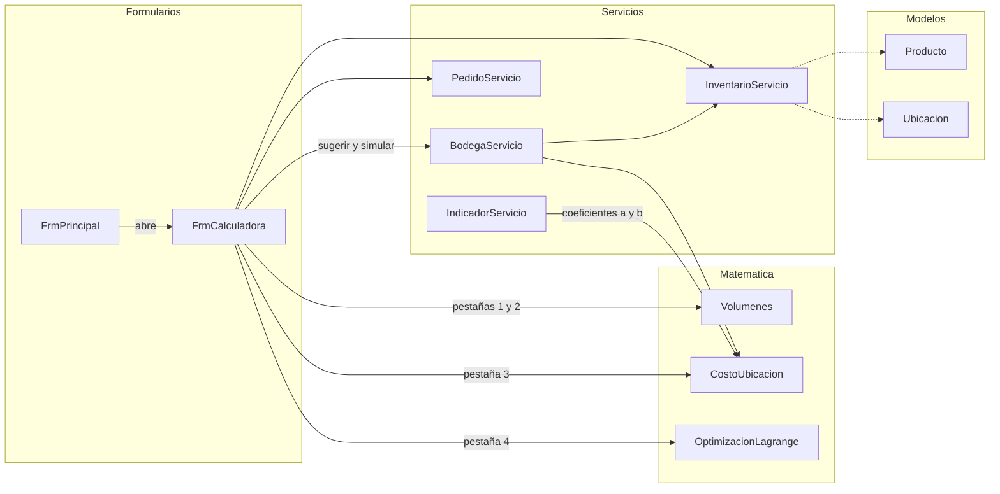
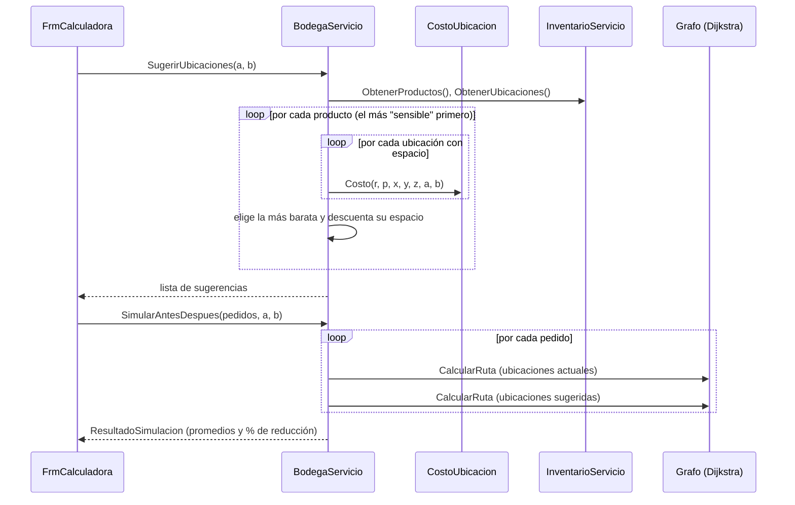

# Guía de estudio 5 — Calculadora matemática (`FrmCalculadora`)

> **Objetivo de esta guía:** que usted pueda explicar **cómo el software usa** los resultados del
> modelo matemático: qué clase hace cada cálculo, de dónde salen los datos y cómo se conecta con el
> resto del programa.
>
> La **deducción paso a paso** de cada fórmula (integrales, derivadas, Lagrange) está en
> [`docs/modelo-matematico.md`](../modelo-matematico.md). Esta guía no la repite: se concentra en el
> **código**. Lea las dos juntas.
>
> Conviene haber leído antes la [guía 4 (Mapa de bodega)](04-FrmMapaBodega.md), porque la pestaña
> de costo de ubicación usa la simulación de `BodegaServicio`.

---

## 1. ¿Qué hace esta pantalla?

Es la pantalla de **Cálculo Multivariable** del proyecto. Tiene **cuatro pestañas**
(`TabControl tabCalculadora`), una por cada parte del modelo matemático:

| Pestaña | Tema de Cálculo | Pregunta que responde en la ferretería |
|---|---|---|
| 1. Montículo de arena | Integral doble en coordenadas polares | ¿Cuántos m³ de arena hay en ese montón? ¿Cuánto vale? |
| 2. Área útil y ocupación | Integral doble (área de una región) | ¿Qué tan llena está la bodega? |
| 3. Costo de ubicación | Función de 3 variables y gradiente | ¿Dónde conviene guardar cada producto? |
| 4. Cantidad a pedir | Multiplicadores de Lagrange | ¿Cuánto pedir de cada producto si el espacio es limitado? |

```
┌──────────────────────────────────────────────────────────────────────────────────┐
│ [Montículo de arena] [Área útil y ocupación] [Costo de ubicación] [Cantidad a pedir (Lagrange)] │
├──────────────────────────────────────────────────────────────────────────────────┤
│  Radio R (m)  [ 2,00 ]        Paraboloide  V = πR²h/2 = 9,425 m³                │
│  Altura h (m) [ 1,50 ]        Cono         V = πR²h/3 = 6,283 m³                │
│  Agregado [CON-004 - Arena ▼] ...                                               │
│  [Calcular volumen]           Comprobación con suma de Riemann: 9,4252 m³       │
└──────────────────────────────────────────────────────────────────────────────────┘
```

---

## 2. Archivos que participan (la "trazabilidad")

| Carpeta | Archivo | Papel en esta pantalla |
|---|---|---|
| `Formularios/` | `FrmPrincipal.cs` | Abre la calculadora desde el menú. |
| `Formularios/` | `FrmCalculadora.cs` | Lee los datos de cada pestaña, llama los cálculos y muestra el resultado. |
| `Matematica/` | `Volumenes.cs` | Pestañas 1 y 2: montículos, área útil, volumen útil, ocupación. |
| `Matematica/` | `CostoUbicacion.cs` | Pestaña 3: la función C(x, y, z) y su gradiente. También la clase `Gradiente`. |
| `Matematica/` | `OptimizacionLagrange.cs` | Pestaña 4: cantidades óptimas y bisección. También `ProductoLagrange` y `ResultadoLagrange`. |
| `Servicios/` | `InventarioServicio.cs` | Productos (ventas, peso, precio, volumen), ubicaciones y volumen ocupado. |
| `Servicios/` | `BodegaServicio.cs` | Pestaña 3: sugerir ubicaciones y simular "antes / después". |
| `Servicios/` | `PedidoServicio.cs` | Pestaña 3: da los pedidos para la simulación. |
| `Modelos/` | `Producto.cs`, `Ubicacion.cs` | Los datos reales que alimentan las fórmulas. |
| `docs/` | `modelo-matematico.md` | La deducción a mano de cada fórmula. |
| `FerreStock.Pruebas/` | `MatematicaPruebas.cs`, `SugerenciasUbicacionPruebas.cs` | Pruebas automáticas. |

### Diagrama de dependencias



### Una diferencia importante con las otras pantallas

En las guías anteriores, el formulario **siempre** hablaba con un **servicio**. Aquí el formulario
llama **directamente** a las clases de `Matematica/`:

```csharp
double parabolico = Volumenes.MonticuloParabolico(radio, altura);   // sin "new", sin servicio
```

**¿Por qué está bien?** Porque las clases de `Matematica/` son **funciones puras**:

| Servicio (ej. `InventarioServicio`) | Clase de `Matematica/` (ej. `Volumenes`) |
|---|---|
| Guarda **datos** (listas de productos). | **No guarda nada.** |
| Se crea **una vez** con `new` y se comparte. | Es `static`: no se crea, se usa directo. |
| Lee y escribe archivos JSON. | No toca archivos. |
| El resultado depende de lo que haya en memoria. | El mismo dato de entrada **siempre** da el mismo resultado. |

Son como una calculadora de bolsillo: reciben números y devuelven números. No hay datos que
proteger, así que no hace falta un servicio en el medio. La lógica sigue **fuera** del formulario:
el formulario solo lee los controles, llama la fórmula y muestra el texto.

> **`static`** significa que el método pertenece a la **clase**, no a un objeto. Por eso se escribe
> `Volumenes.MonticuloConico(...)` y no `new Volumenes().MonticuloConico(...)`. `Math.Sqrt` de .NET
> funciona igual.

---

## 3. ¿Cómo llega el programa hasta esta pantalla?

```
FrmPrincipal                                          (FrmPrincipal.cs:204)
   new FrmCalculadora(inventario, bodega, pedidos).ShowDialog();
```

Recibe **tres** servicios, los mismos objetos compartidos de siempre. Al abrir
(`FrmCalculadora_Load`):

```
FrmCalculadora_Load
 ├─ por cada producto del inventario:
 │     ├─ si su Unidad es "m³" → al combo de agregados (pestaña 1: arena, gravilla)
 │     └─ siempre               → al combo de productos (pestaña 3)
 ├─ nudA, nudB ← CostoUbicacion.CoeficienteDistancia (1,0) y CoeficienteAltura (0,1)
 └─ CargarEjemploLagrange()   → llena la tabla de la pestaña 4 con 3 productos reales
```

Fíjese que **todas** las pestañas usan **datos reales** del inventario (precio de la arena, ventas
y peso del cemento, ubicaciones de los estantes). La calculadora no es un ejercicio aislado: aplica
el modelo a **la ferretería**.

---

## 4. Pestaña 1 — Volumen del montículo de arena

📖 Deducción: `modelo-matematico.md`, sección 2.

### 4.1 El recorrido

```
btnCalcularVolumen_Click
 ├─ radio = nudRadio, altura = nudAltura                 (por defecto R = 2 m, h = 1,5 m)
 ├─ Volumenes.MonticuloParabolico(radio, altura)         → πR²h/2  = 9,425 m³
 ├─ Volumenes.MonticuloConico(radio, altura)             → πR²h/3  = 6,283 m³
 ├─ Volumenes.MonticuloParabolicoNumerico(radio, altura, 100) → suma de Riemann ≈ 9,4252 m³
 └─ si hay agregado elegido: volumen × agregado.PrecioVenta    → valor del montículo en pesos
```

### 4.2 Las dos fórmulas en código

```csharp
public static double MonticuloParabolico(double radio, double altura)
{
    ValidarPositivos(radio, altura);
    return Math.PI * radio * radio * altura / 2;     // resultado de la integral doble en polares
}
```

El software **no calcula la integral**: los estudiantes la resuelven a mano y el código solo
**evalúa el resultado** (πR²h/2). Así lo pide el plan del proyecto.

### 4.3 ¿Y cómo sabemos que la fórmula está bien? La suma de Riemann

`MonticuloParabolicoNumerico` aproxima la **misma integral** sumando pedacitos, como en la
definición de integral:

```csharp
double deltaR = radio / divisiones;                 // ancho de cada anillo
double deltaTheta = 2 * Math.PI / divisiones;       // ángulo de cada tajada
for (int i = 0; i < divisiones; i++)                // por cada anillo...
{
    double r = (i + 0.5) * deltaR;                  // punto medio del anillo
    double z = altura * (1 - (r * r) / (radio * radio));   // altura del montículo ahí
    for (int j = 0; j < divisiones; j++)            // ...y cada tajada
    {
        suma += z * r * deltaR * deltaTheta;        // altura × área del pedacito (r·Δr·Δθ)
    }
}
```

```
 Vista desde arriba del montículo:        Cada pedacito:
       ╱──┬──╲                            área ≈ r · Δr · Δθ
     ╱  ╲ │ ╱  ╲                          volumen ≈ z(r) · r · Δr · Δθ
    │ ───(●)─── │  ← anillos (Δr)
     ╲  ╱ │ ╲  ╱     y tajadas (Δθ)
       ╲──┴──╱
```

**El factor `r`** en `r·Δr·Δθ` es el **jacobiano** de las coordenadas polares: un pedacito lejos
del centro es más grande que uno cerca, aunque tengan el mismo Δr y Δθ.

Con 100 × 100 divisiones da 9,4252 m³ contra 9,4248 m³ de la fórmula. **Dos métodos
independientes dan lo mismo**: es una prueba de que la deducción a mano está bien.

> Este doble `for` es un buen ejemplo para la sustentación de **Programación** (ciclos anidados)
> y de **Cálculo** (definición de integral) a la vez.

---

## 5. Pestaña 2 — Área útil y ocupación

📖 Deducción: `modelo-matematico.md`, sección 3.

```
btnCalcularArea_Click
 ├─ pasillos    = Volumenes.AreaPasillos(3, 1,5, 26)        = 117 m²
 ├─ areaUtil    = Volumenes.AreaUtil(26, 16, 117)           = 416 − 117 = 299 m²
 ├─ volumenUtil = Volumenes.VolumenUtil(299, 2)             = 598 m³
 ├─ ocupado     = inventario.VolumenOcupado()               ← Σ stock × volumen unitario (guía 1)
 ├─ capacidadEstantes = Σ CapacidadM3 de todas las ubicaciones (un foreach en el formulario)
 └─ dos porcentajes con Volumenes.PorcentajeOcupacion(...)
       ├─ ocupado / volumen útil teórico
       └─ ocupado / capacidad de los estantes registrados
```

**¿Por qué dos ocupaciones?** La primera usa el área **teórica** (toda la bodega menos pasillos).
La segunda usa la capacidad **real** de los estantes que existen en `ubicaciones.json`. La segunda
es más realista y es la que usa el módulo de **Indicadores**. Compararlas muestra cuánto espacio
de la bodega **no** se está aprovechando con estantes.

**Conexión con otras pantallas:** `VolumenOcupado()` depende del **stock** de cada producto. Si se
registra una entrada en Movimientos, la ocupación sube. El dato cambia en una pantalla y se nota en otra.

---

## 6. Pestaña 3 — Costo de ubicación y gradiente

📖 Deducción: `modelo-matematico.md`, sección 4.

### 6.1 La función de tres variables

```
C(x, y, z) = r · ( a·√(x² + y²) + b·p·z )
```

| Símbolo | Significado | De dónde lo saca el código |
|---|---|---|
| r | Ventas del mes (cuántas veces se va a buscar) | `producto.VentasMes` |
| p | Peso de una unidad (kg) | `producto.PesoKg` |
| x, y | Posición en planta (m desde el mostrador) | `ubicacion.X`, `ubicacion.Y` |
| z | Altura del nivel del estante (m) | `ubicacion.Z` |
| √(x² + y²) | Distancia en línea recta al mostrador | se calcula |
| a, b | Cuánto importa caminar y cuánto importa subir peso | `nudA`, `nudB` (por defecto 1 y 0,1) |

### 6.2 Calcular el costo de un producto

```
cmbProductoCosto_SelectedIndexChanged          ← al elegir el producto
 ├─ ubicacion = bodega.BuscarUbicacion(producto.UbicacionId)
 └─ llena nudX, nudY, nudZ con la ubicación ACTUAL del producto

btnCalcularCosto_Click
 ├─ CostoUbicacion.Costo(r, p, x, y, z, a, b)
 └─ CostoUbicacion.CalcularGradiente(r, p, x, y, z, a, b)  → objeto Gradiente {X, Y, Z}
```

Ejemplo con el **cemento gris** (r = 120, p = 50) en D-01-1 = (22, 4, 0,2):

```
C  = 120 · (1 · √(22² + 4²) + 0,1 · 50 · 0,2) = 120 · (22,36 + 1) ≈ 2.803
∇C ≈ (118,1 ; 21,5 ; 600)
```

El usuario puede **cambiar** x, y, z a mano para ver qué pasaría. Por ejemplo, en A-01-1 = (4, 4, 0,2)
el costo baja a ≈ 799 (un 71 % menos).

### 6.3 El gradiente en código

```csharp
double distanciaPlanta = Math.Sqrt(x * x + y * y);
if (distanciaPlanta > 0)                                  // ← en el origen la derivada no existe
{
    g.X = ventasMes * a * x / distanciaPlanta;            // ∂C/∂x
    g.Y = ventasMes * a * y / distanciaPlanta;            // ∂C/∂y
}
g.Z = ventasMes * b * pesoKg;                             // ∂C/∂z
```

- Las tres componentes son **positivas**: el costo **sube** al alejarse del mostrador o al subir de
  nivel. Para **bajarlo** hay que ir en dirección **−∇C**: hacia el mostrador y hacia abajo.
- El `if` evita una **división entre cero** cuando el producto está justo en el mostrador (0, 0).
  Ahí se dejan las componentes x e y en 0. Es un caso donde el **código** obliga a pensar en un
  detalle **matemático** (la raíz no es derivable en el origen).
- La componente z (600) es mucho mayor que las otras: para el cemento, que pesa 50 kg, **bajarlo de
  nivel** importa mucho. Por eso los productos pesados deben ir abajo.

`Gradiente` es una clase pequeña con tres propiedades (X, Y, Z). El método devuelve un **objeto**
en vez de tres números sueltos, porque un método solo puede devolver un valor.

### 6.4 Sugerir ubicaciones y simular (aquí se conecta con el Mapa)

```
btnSugerir_Click
 ├─ bodega.SugerirUbicaciones(a, b)                       → List<SugerenciaUbicacion>
 │     (algoritmo voraz: los productos con mayor r·(a + b·p) escogen primero
 │      la ubicación más barata donde quepa su volumen)
 │     └─ llena dgvSugerencias; en verde los que conviene mover
 └─ bodega.SimularAntesDespues(pedidos.ObtenerPedidos(), a, b)
       ├─ por cada pedido: CalcularRuta con ubicaciones ACTUALES   (guía 4, sección 6)
       ├─ por cada pedido: CalcularRuta con ubicaciones SUGERIDAS
       └─ promedios → "recorrido X m → Y m; tiempo A → B min (N % menos)"
```



**Esta es la respuesta numérica a la pregunta de investigación.** El **Cálculo** dice dónde
conviene cada producto (costo mínimo), las **Estructuras de datos** (grafo + Dijkstra) miden cuánto
se camina con esas ubicaciones, y la **simulación** compara el antes y el después. Tres asignaturas
trabajando en un solo botón.

> **Importante:** las sugerencias **no mueven** ningún producto. Es una simulación: usa la
> segunda versión de `CalcularRuta`, que recibe un diccionario "código → ubicación" (guía 4,
> sección 8). Hay un `TODO estudiante` para agregar un botón "Aplicar sugerencias".

**¿Por qué voraz y no "cada producto a su mínimo"?** Si cada producto buscara solo su costo mínimo,
**todos** querrían el estante más cercano al mostrador, y no caben. Por eso los productos más
"sensibles" escogen primero y cada elección descuenta espacio.

### 6.5 Los coeficientes a y b se usan en dos lugares

```csharp
// CostoUbicacion.cs
public const double CoeficienteDistancia = 1.0;   // a
public const double CoeficienteAltura = 0.1;      // b
```

- Aquí, como valores **iniciales** de `nudA` y `nudB` (el usuario los puede cambiar).
- En `IndicadorServicio`, para la simulación del reporte de indicadores.

Al ser **constantes en un solo lugar**, si se ajustan con lo observado en la ferretería (hay un
`TODO estudiante`), cambian en las dos pantallas a la vez.

---

## 7. Pestaña 4 — Cantidad a pedir con Lagrange

📖 Deducción: `modelo-matematico.md`, sección 5.

### 7.1 El problema

Se quiere pedir varios productos minimizando el costo anual (pedir muchas veces es caro; guardar
mucho también), pero **el espacio de la bodega es limitado**:

```
Minimizar   Σ ( Dᵢ·Sᵢ / Qᵢ  +  hᵢ·Qᵢ / 2 )         ← costo de pedir + costo de mantener
sujeto a    Σ vᵢ·Qᵢ ≤ V                            ← lo que se pide debe caber
```

Con Lagrange se llega a:

```
Qᵢ(λ) = √( 2·Dᵢ·Sᵢ / (hᵢ + 2λ·vᵢ) )
```

| Símbolo | Columna de la tabla | En el ejemplo |
|---|---|---|
| D | Demanda anual | ventas del mes × 12 |
| S | Costo de hacer un pedido | $50.000 |
| h | Costo de mantener una unidad un año | 25 % del precio de compra |
| v | Volumen de una unidad (m³) | `producto.VolumenUnitarioM3` |
| V | `nudVolumenDisponible` | 4 m³ |

### 7.2 Del formulario a la clase

```
FrmCalculadora_Load → CargarEjemploLagrange()
   para CON-001 (cemento), CON-006 (varilla), PLO-001 (tubo PVC):
      inventario.BuscarPorCodigo(codigo) → llena una fila con D, S, h, v

btnResolverLagrange_Click
 ├─ productos = LeerTablaLagrange()            ← convierte cada fila en un ProductoLagrange
 │     └─ LeerNumero(...) con double.TryParse  ← si una celda no es número → ArgumentException
 ├─ r = OptimizacionLagrange.Resolver(productos, V)    → ResultadoLagrange
 └─ muestra por producto: Q sin restricción (λ = 0), Q óptimo, volumen
```

La tabla `dgvLagrange` es **editable**: el estudiante puede cambiar los números o agregar filas
para probar otros casos. Por eso el formulario valida cada celda con `double.TryParse`.

`ProductoLagrange` es una clase **solo para este cálculo** (no es un `Producto` del inventario):
tiene exactamente los 4 datos que pide la fórmula. Así `OptimizacionLagrange` no depende de cómo
esté hecho el inventario.

### 7.3 El algoritmo de `Resolver` (bisección)

```
Paso 1: probar λ = 0 (lote económico clásico).
        ¿Σ vᵢ·Qᵢ(0) ≤ V?  → sí: esa es la respuesta, la restricción no "aprieta".
Paso 2: si no cabe, buscar un λ "alto" con el que sí quepa: empezar en 1 y duplicar.
Paso 3: bisección entre bajo = 0 (no cabe) y alto (sí cabe):
           medio = (bajo + alto) / 2
           si con medio NO cabe → bajo = medio
           si con medio SÍ cabe → alto = medio
        hasta que el intervalo sea diminuto.
Paso 4: con λ = alto, calcular cantidades, volumen y costo.
```

**¿Por qué funciona la bisección?** Porque al **aumentar λ**, el denominador `hᵢ + 2λ·vᵢ` crece,
cada Qᵢ **disminuye** y el volumen total **baja**. Como el volumen solo baja, existe un único λ
donde el volumen es exactamente V, y partiendo el intervalo a la mitad se encierra cada vez más.
(Es la misma idea de la **búsqueda binaria** del comparador de algoritmos, pero sobre números reales.)

### 7.4 Traza con el ejemplo (V = 4 m³)

Paso 1 — con λ = 0:

| Producto | Q (λ = 0) | v·Q |
|---|---:|---:|
| Cemento gris 50 kg | 143,4 | 5,16 m³ |
| Varilla 1/2" | 180,9 | 0,14 m³ |
| Tubo PVC 1/2" | 188,1 | 0,51 m³ |
| **Total** | | **5,82 m³ > 4** → no cabe |

Paso 2 — duplicar: 1, 2, 4, ..., 65.536 (aún no cabe), **131.072** (ya cabe). Intervalo [0, 131.072].

Paso 3 — primeras vueltas de la bisección:

| Vuelta | bajo | alto | medio | ¿Cabe con medio? | Cambia |
|---|---:|---:|---:|---|---|
| 1 | 0 | 131.072 | 65.536 | No | bajo |
| 2 | 65.536 | 131.072 | 98.304 | No | bajo |
| 3 | 98.304 | 131.072 | 114.688 | No | bajo |
| 4 | 114.688 | 131.072 | 122.880 | No | bajo |
| 5 | 122.880 | 131.072 | 126.976 | **Sí** | alto |
| ... | | | | | |

Tras unas 30 vueltas: **λ ≈ 125.681**, y las cantidades quedan en cemento 94,7, varilla 177,7 y
tubo 165,9, que ocupan exactamente **4,000 m³**.

**Interpretación para la sustentación:** el cemento es el que más se reduce (de 143 a 95 bultos)
porque es el que más espacio ocupa por unidad; la varilla casi no cambia. Y **λ** tiene sentido
económico: es cuánto bajaría el costo anual por cada m³ adicional de bodega.

---

## 8. Validaciones y manejo de errores

Todas las clases de `Matematica/` validan sus entradas y lanzan `ArgumentException`; el formulario
las atrapa y las muestra con `MessageBox`, igual que en las otras pantallas.

| Clase / método | Regla | Mensaje |
|---|---|---|
| `Volumenes` (montículos, área, volumen) | Medidas > 0 | "Las medidas deben ser mayores que cero." |
| `Volumenes.AreaPasillos` | Datos no negativos | "Los datos de los pasillos no pueden ser negativos." |
| `Volumenes.AreaUtil` | Pasillos entre 0 y el área total | "El área de pasillos debe estar entre 0 y el área total de la bodega." |
| `Volumenes.PorcentajeOcupacion` | Volumen útil > 0 | "El volumen útil debe ser mayor que cero." |
| `OptimizacionLagrange.Validar` | Al menos un producto, V > 0, todos los datos > 0 | "Todos los datos de X deben ser mayores que cero." |
| `FrmCalculadora.LeerNumero` | Cada celda es un número | "El valor 'abc' de la columna ... no es un número." |
| `FrmCalculadora` (costo) | Elegir un producto | "Elija un producto." |

**¿Por qué validar en una fórmula?** Porque un radio negativo daría un volumen "válido" (el radio
se eleva al cuadrado) pero **sin sentido**, y un área útil negativa daría ocupaciones absurdas.
Más vale un mensaje claro que un número equivocado que nadie nota.

---

## 9. Pruebas automáticas relacionadas

**`MatematicaPruebas.cs`**:

| Prueba | Qué demuestra |
|---|---|
| `MonticuloParabolico_EsPiRCuadradoHMedios` | La fórmula πR²h/2. |
| `MonticuloConico_EsDosTerciosDelParabolico` | Cono = 2/3 del paraboloide. |
| `SumaDeRiemann_SeAcercaALaFormula` | La comprobación numérica (sección 4.3). |
| `AreaUtilYOcupacion` | El ejemplo de la pestaña 2. |
| `MedidasInvalidas_LanzanError` | Las validaciones. |
| `Costo_SeCalculaConLaFormula`, `Costo_EsMenorCercaDelMostradorYAbajo` | La función C(x, y, z). |
| `Gradiente_ApuntaHaciaAfueraYHaciaArriba` | Las componentes son positivas. |
| `Gradiente_EnElOrigen_NoDivideEntreCero` | El `if` de la sección 6.3. |
| `SiCabe_EsElLoteEconomicoClasico` | Con espacio de sobra, λ = 0. |
| `SiNoCabe_LlenaExactamenteElEspacio` | La bisección llena exactamente V. |
| `ConRestriccion_ElCostoEsMayorQueSinRestriccion` | Tener menos espacio cuesta más. |

**`SugerenciasUbicacionPruebas.cs`**:

| Prueba | Qué demuestra |
|---|---|
| `Sugerencias_RespetanLaCapacidadDeCadaUbicacion` | El voraz no llena una ubicación de más. |
| `Sugerencias_ElCementoQuedaMasCercaDelMostrador` | El cemento sale de D-01-1 hacia una ubicación más barata. |
| `Simulacion_ConUbicacionesSugeridas_BajaElTiempoDeAlistamiento` | Con los 5 pedidos de ejemplo, el tiempo baja. |

Fíjese que las pruebas de matemáticas **no** necesitan carpeta temporal ni servicios: como las
clases son funciones puras, basta con llamarlas. Es otra ventaja de que sean `static` y sin datos.

---

## 10. Preguntas probables de la sustentación (con respuesta)

**1. ¿El software calcula las integrales?**
No. Las integrales se resuelven a mano (`modelo-matematico.md`) y el software evalúa el resultado.
La suma de Riemann solo **comprueba** que la fórmula deducida es correcta.

**2. ¿Por qué el paraboloide da más volumen que el cono?**
Porque el cono es más "puntudo": con el mismo radio y altura tiene lados rectos y menos material.
El paraboloide es πR²h/2 y el cono πR²h/3; el paraboloide tiene 50 % más.

**3. ¿Qué es el `r` de `r·Δr·Δθ` en la suma de Riemann?**
El jacobiano de las coordenadas polares: los pedacitos lejos del centro son más grandes.

**4. ¿Qué dice el gradiente del costo?**
Que el costo sube al alejarse del mostrador y al subir de nivel; para bajarlo hay que mover el
producto hacia el origen y hacia abajo (dirección −∇C).

**5. ¿Por qué el código tiene un `if` en el gradiente?**
Porque en el origen √(x² + y²) = 0 y la derivada no existe (habría división entre cero).

**6. ¿Cómo eligen la ubicación sugerida?**
Con un algoritmo voraz: los productos con mayor r·(a + b·p) escogen primero la ubicación de menor
costo donde quepa su volumen, y ese espacio se descuenta.

**7. ¿Qué es λ y cómo lo encuentran?**
El multiplicador de Lagrange: cuánto bajaría el costo por cada m³ extra de bodega. Se encuentra por
bisección, porque al aumentar λ el volumen pedido siempre disminuye.

**8. ¿Por qué el formulario llama a `Matematica/` directamente y no a un servicio?**
Porque esas clases son funciones puras (`static`, sin datos ni archivos). No hay nada que proteger
ni compartir; un servicio en el medio no aportaría nada.

**9. ¿Cómo responde esta pantalla la pregunta de investigación?**
El botón "Sugerir ubicaciones" calcula las ubicaciones de menor costo y simula las rutas de todos
los pedidos antes y después, mostrando el porcentaje en que baja el tiempo de alistamiento.

**10. ¿Las sugerencias mueven los productos?**
No, solo simulan. Los productos se quedan donde están hasta que alguien los cambie en Productos.

---

## 11. Ejercicios para practicar

1. **Verificar a mano.** Calcule el volumen de un montículo de R = 1,5 m y h = 1 m con las dos
   fórmulas. Compruébelo en la pestaña 1.
2. **Riemann.** Cambie en el código el `100` de `MonticuloParabolicoNumerico` por 5, 10 y 1.000.
   Anote cómo se acerca a la fórmula. ¿Por qué con 1.000 tarda más? (Pista: ¿cuántas veces se
   repite la línea `suma += ...`?)
3. **Gradiente a mano.** Calcule C y ∇C para la varilla 1/2" (r = 150, p = 5,97) en su ubicación
   D-02-1 = (22, 6, 0,2). Compare con la pestaña 3.
4. **Coeficientes reales** (`TODO estudiante` en `CostoUbicacion.cs`): proponga y justifique a y b
   con lo observado en la ferretería. ¿Cómo cambia la simulación?
5. **Aplicar sugerencias** (`TODO estudiante` en `FrmCalculadora.cs`): diseñe (en papel) un botón que
   mueva los productos a la ubicación sugerida. ¿Qué método de qué servicio debería usar?
   ¿Hay que guardar algún archivo? (Repase la guía 1, `EditarAsync`.)
6. **Bisección.** Con la tabla de ejemplo, resuelva con V = 6 m³ y con V = 2 m³. Explique por qué
   con 6 m³ λ da 0.
7. **Prueba nueva.** Escriba una prueba en `MatematicaPruebas.cs` que verifique que, con V muy
   pequeño, el costo total es mayor que con V = 4.

---

## 12. Resumen en una frase

> **FrmCalculadora** lee los datos (muchos tomados del **InventarioServicio**) y llama directamente a
> las clases `static` de **Matematica/** —**Volumenes**, **CostoUbicacion** y **OptimizacionLagrange**—,
> que solo evalúan las fórmulas deducidas a mano; y para la pregunta de investigación usa
> **BodegaServicio**, que combina el **costo** con el **grafo** para simular cuánto bajaría el tiempo
> de alistamiento.
